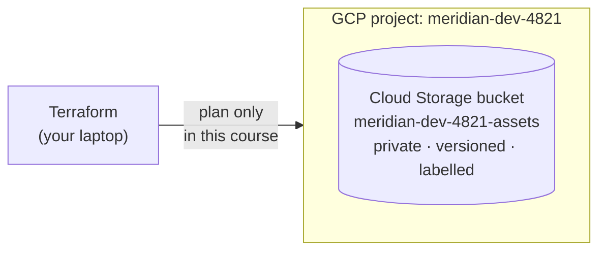

# Lesson 01 — Terraform Basics

**Phase 1 · Beginner** · Running project: *Meridian Books* storefront

> You are the first platform engineer at Meridian Books, a small online bookstore
> moving to Google Cloud. Every lesson adds to the same infrastructure. Today you
> create its first resource: a private bucket for the storefront's static assets.

## Learning objectives

By the end of this lesson you can:

- explain what a **provider**, **resource**, **data source**, **variable** and **output** are;
- pin provider versions and explain why unpinned providers are dangerous;
- run the core workflow: `init → fmt → validate → plan` (and know what `apply`/`destroy` would do);
- read a plan and explain the dependency graph Terraform builds.

## 1. Concepts

### Terraform in one paragraph

Terraform reads `.tf` files written in **HCL** and works out what infrastructure
*should* exist. It compares that with what its **state** says *does* exist and
produces a **plan**: the create, update and delete actions needed to make reality
match the code. `apply` carries out the plan. In this course we stop at `plan`.
A plan you can read and defend is the core skill. Applying it is the easy part.

### The building blocks

| Block | Purpose | Example |
|---|---|---|
| `terraform { required_providers }` | Which plugins to download, and which versions | `google = { source = "hashicorp/google", version = "~> 8.12" }` |
| `provider "google"` | How to talk to the API (project, region, credentials) | `project = var.project_id` |
| `resource` | Something Terraform creates and manages | `google_storage_bucket` |
| `data` | Something Terraform only *reads* | `google_client_config` |
| `variable` | An input, so the same code works for dev and prod | `var.region` |
| `output` | A value printed after apply, and readable by other configurations | the bucket URL |
| `locals` | A named expression, for reuse inside one configuration | a shared label map |

### Where providers come from

`terraform init` downloads providers from the **Terraform Registry**
(`registry.terraform.io`). The course setup downloads them once into a shared cache
(`python course.py setup`), so each lesson initializes in seconds.

`version = "~> 8.12"` means *8.12 or newer, but below 9.0*. Major versions can
contain breaking changes, so production code always pins.

### The dependency graph

When one resource refers to another's attribute (`google_storage_bucket.assets.url`),
Terraform records an edge in its graph. It creates resources in dependency
order and runs independent ones in parallel. You almost never write
`depends_on`. References create the ordering for you.

## 2. Architecture



## 3. How this course validates your work (no cloud account needed)

`python course.py check 01` runs these steps:

1. `terraform fmt -check` checks formatting.
2. `terraform init` downloads providers from the Registry, via the shared cache.
3. `terraform validate` checks syntax, types and references.
4. `terraform plan` runs with a **fake credential** and produces the plan JSON. Real
   Google credentials on your machine are removed from the environment, so this step
   can never touch a real project.
5. **Requirement checks** read the plan and confirm each lab requirement. They test
   *what would be built*, not how you spelled it. Any correct solution passes.

Data sources that call live Google APIs (e.g. `google_compute_zones`) cannot work
offline. The labs only use data sources that resolve locally.

## 4. Lab files

| File | What you'll do |
|---|---|
| [lab.md](lab.md) | Guided lab: requirements R1.1–R1.9 |
| [challenge.md](challenge.md) | Challenge: C1.1–C1.4, less guidance |
| [broken/](broken/) | Troubleshooting: a teammate's repo that won't validate |

```powershell
python course.py start 01
```

## 5. If this were real (optional, costs money)

With a real project and `gcloud auth application-default login`, `terraform apply`
would create the bucket in about 5 seconds. An empty bucket costs nothing.
`terraform destroy` removes it, and the destroy fails if objects remain, because
`force_destroy = false`. That is deliberate protection.
