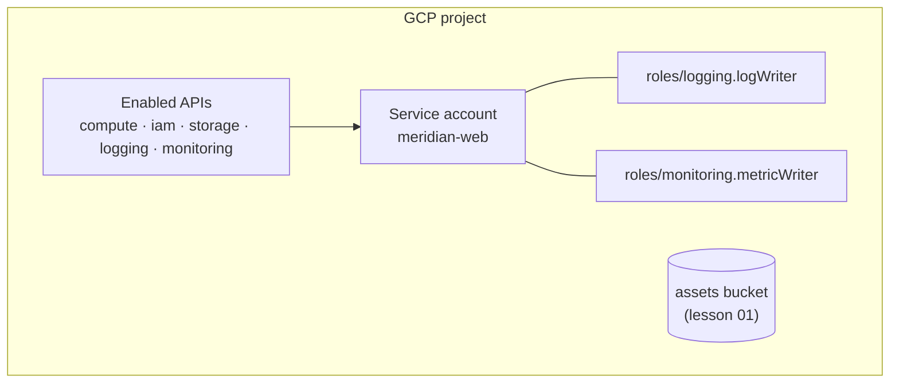

# Lesson 02 — Google Cloud Foundations: Projects, APIs and Basic IAM

**Phase 1 · Beginner** · Builds on lesson 01

> Before Meridian can run a single VM, the project needs its APIs switched on and
> an identity for the web tier, with only the permissions it needs.

## Learning objectives

- Explain the GCP resource hierarchy: organization → folders → projects → resources.
- Know where billing, quotas, regions and zones fit.
- Explain how Terraform authenticates (ADC, impersonation) and why this course needs none of it.
- Enable APIs with `google_project_service`, and explain `disable_on_destroy`.
- Create a service account and grant it **predefined** roles with **additive** IAM.

## 1. Concepts

### Projects, billing and APIs

A **project** is the unit of ownership, billing and quota. Almost every
Google Cloud service is off by default in a new project. Its API must be
**enabled** first, and Terraform can do this with `google_project_service`.
If Terraform tries to create a VM before `compute.googleapis.com` is on, the
apply fails. A dependency fixes that.

`disable_on_destroy = false` matters. With the default (`true`), destroying
your config would *switch the API off* for everyone in the project.

### Regions and zones

A **region** (`us-central1`) is a geographic area. A **zone** (`us-central1-a`)
is an isolated failure domain inside it. Resources are **global** (VPC
networks), **regional** (subnets, Cloud SQL), or **zonal** (VMs, disks).
You'll design across zones in lesson 21.

### How Terraform would authenticate (for real)

| Method | Use it for |
|---|---|
| `gcloud auth application-default login` (ADC) | your laptop |
| Service account **impersonation** (`impersonate_service_account`) | humans running Terraform as a tightly scoped identity |
| **Workload Identity Federation** | CI/CD (lesson 16). No keys at all. |
| Service account key files | **avoid.** Long-lived secrets that leak. |

The course checker removes all of these from the environment and plans with a
fake token, so a real project can never be touched by accident.

### IAM in 60 seconds

*Who* (principal) can do *what* (role = bundle of permissions) on *which resource*.

- **Basic roles** (`owner`, `editor`, `viewer`) are huge. Never grant them to workloads.
- **Predefined roles** (`roles/logging.logWriter`) are narrow and maintained by Google.
- **Custom roles** are your own bundles (lesson 10).

Terraform has three styles of project IAM resource, and the difference is critical:

| Resource | Behaviour | Risk |
|---|---|---|
| `google_project_iam_member` | **Adds** one role for one principal | Safe default |
| `google_project_iam_binding` | **Owns** all members of one role | Silently removes grants made elsewhere |
| `google_project_iam_policy` | **Owns** the entire project policy | Can lock everyone out, including you |

## 2. Architecture



## 3. Lab files

- [lab.md](lab.md): R2.1 – R2.8
- [challenge.md](challenge.md): C2.1 – C2.4 (budgets plus your first native `terraform test`)
- [broken/](broken/): a dependency cycle

```powershell
python course.py start 02              # official starter (= lesson 01 solution)
python course.py start 02 --from-mine  # or continue from your own lesson 01 work
```

## 4. If this were real

APIs, service accounts and IAM grants are free. Budgets are free, but they need
`roles/billing.costsManager` on the billing account, which is often a separate team.
A budget **alerts**. It does not cap spending.
