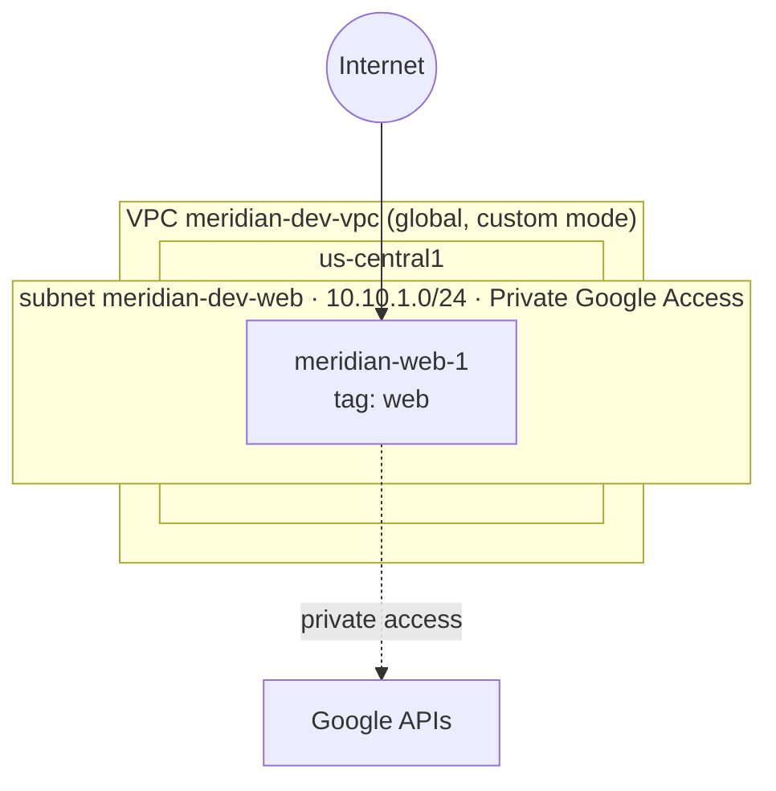

# Lesson 04 — VPC Fundamentals

**Phase 1 · Beginner** · Builds on lesson 03

> The `default` network was fine for a first VM. It is not fine for a business:
> it has a subnet in every region, ranges you didn't choose, and permissive
> default firewall rules. Today Meridian gets its own network.

## Learning objectives

- Explain VPC networks, subnets, routes, and how they map to regions.
- Compare auto-mode and custom-mode VPCs, and pick custom for production.
- Plan CIDR ranges: network address, prefix length, reserved IPs, non-overlap.
- Move a VM into a new subnet, and predict what Terraform will replace.

## 1. Concepts

### Global network, regional subnets

In Google Cloud a **VPC network is global**. A **subnet is regional**. One
VPC can have subnets in `us-central1` and `europe-west1`, and their VMs talk over
Google's backbone with internal IPs and no VPN. (In AWS, by contrast, a VPC is regional.)

| | Auto mode | Custom mode |
|---|---|---|
| Subnets | One per region, created for you, in `10.128.0.0/9` | Only the ones you define |
| Ranges | Fixed, so they collide when you peer two auto-mode networks | You plan them |
| Use for | Experiments | Everything else |

### CIDR planning

`10.10.1.0/24`: the first 24 bits are the network, the remaining 8 bits number
256 addresses. Google Cloud reserves 4 in every subnet (`.0`, `.1`, `.254`, `.255`).

A simple plan for Meridian:

| Range | Use |
|---|---|
| `10.10.0.0/16` | Meridian dev VPC (room for 256 /24 subnets) |
| `10.10.1.0/24` | web tier |
| `10.10.2.0/24` | app tier (lesson 5) |
| `10.20.0.0/16` | reserved for prod, so dev and prod can be peered later (lesson 7) |

**Never overlap ranges you might ever connect.** Peering and VPN both refuse overlapping ranges.

### Routes

Every VPC gets a **subnet route** per subnet (so internal traffic just works)
and a **default route** `0.0.0.0/0` to the internet gateway. A VM still needs an
external IP, or Cloud NAT (lesson 7), to actually use that default route.

### Private Google Access

Lets VMs **without** external IPs reach Google APIs (Cloud Storage, Logging) over
Google's network. Turn it on for every subnet. It's free.

### Moving a VM between networks

`network_interface` is fixed at creation time for most fields. Changing the subnet
makes Terraform **destroy and recreate** the VM. Look for `-/+` and
`# forces replacement` in a plan. Always read the plan before an apply that touches networking.

## 2. Architecture

## 3. Lab files

- [lab.md](lab.md): R4.1 – R4.7
- [challenge.md](challenge.md): C4.1 – C4.4 (`for_each` subnets, flow logs, validation tests)
- [broken/](broken/): a CIDR that *looks* right

## 4. If this were real

VPCs, subnets and routes are free. Flow logs are billed per GB of logs generated.
That's why the challenge samples 50%.
