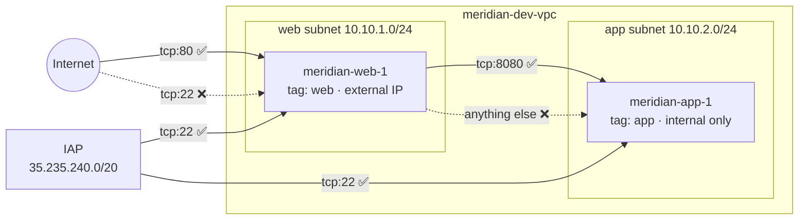

# Lesson 05 — Cloud Networking I and Firewalls

**Phase 1 · Beginner** · Builds on lesson 04 · **Phase 1 capstone**

> Meridian adds a private API tier behind the web server. Your job: let exactly
> the right traffic through and nothing else, and prove it.

## Learning objectives

- Explain VPC firewall rule evaluation: direction, priority, action, targets, sources.
- Design a connectivity matrix before writing a single rule.
- Use network tags and service accounts as firewall targets, and know why SAs are stronger.
- Administer private VMs through IAP instead of public SSH.
- Troubleshoot "connection timed out" by reasoning about rules.

## 1. Concepts

### How a packet is judged

Every VPC has two **implied rules** you can't see or delete:

| Implied rule | Priority |
|---|---|
| deny all **ingress** | 65535 (lowest) |
| allow all **egress** | 65535 (lowest) |

Your rules sit on top. For each connection, Google Cloud collects the rules that
match **direction + target + source/destination + protocol/port**, then:

1. The lowest **priority number** wins (0 = highest, 65535 = lowest).
2. At equal priority, **deny beats allow**.
3. Firewalls are **stateful**: if a connection is allowed in, its replies are allowed out.

A packet from VM A to VM B must pass **A's egress** rules *and* **B's ingress** rules.

### Targets and sources

| Field | Meaning |
|---|---|
| `target_tags` / `target_service_accounts` | Which VMs the rule protects. **Neither = every VM in the VPC.** |
| `source_ranges` | CIDR blocks the traffic comes from (ingress) |
| `source_tags` / `source_service_accounts` | VMs the traffic comes from, matched by their **internal** IP |
| `destination_ranges` | Where traffic goes (egress) |

**Tags vs. service accounts:** anyone with `compute.instances.setTags` can add a
`web` tag to any VM and inherit its access. Changing a VM's service account
requires `iam.serviceAccountUser` on that account, which is a much higher bar.
Production rules between tiers should target service accounts.

### IAP TCP forwarding

`gcloud compute ssh --tunnel-through-iap` wraps SSH in an HTTPS tunnel through
Identity-Aware Proxy. Traffic arrives from `35.235.240.0/20`, and IAM decides who
may open a tunnel. Port 22 is never exposed to the internet, and VMs need **no
external IP**.

### How the course "tests connectivity" offline

`coursekit/firewall.py` is a model of the rules above. It reads your plan and
answers questions like *"can the internet reach the app VM on 8080?"*,
reporting **which rule decided**. On a real project you'd run `curl` and `nc` from
each VM, or use **Connectivity Tests** (Network Intelligence Center), which does
the same analysis against live config.

Model limitations: no hierarchical firewall policies, routes or NAT, and VM
IPs are approximated by their subnet range.

## 2. Architecture and connectivity matrix

| # | From | To | Port | Expected |
|---|---|---|---|---|
| 1 | internet | web | 80 | ✅ allow |
| 2 | internet | web | 22 | ❌ deny |
| 3 | IAP | web, app | 22 | ✅ allow |
| 4 | web | app | 8080 | ✅ allow |
| 5 | web | app | 22, 5432, ... | ❌ deny |
| 6 | internet | app | any | ❌ deny (no external IP) |

## 3. Lab files

- [lab.md](lab.md): R5.1 – R5.10
- [challenge.md](challenge.md): C5.1 – C5.4 (service-account rules, egress lockdown, logging)
- [broken/](broken/): "the web server times out talking to the API"

## 4. Phase 1 complete

After this lesson Meridian has a reproducible web server in a custom network
with controlled access, defined entirely in Terraform. Phase 2 starts by
**refactoring all of it into reusable modules** with remote state.

## 5. If this were real

Firewall rules are free. Firewall rule **logging** is billed as Cloud Logging
ingestion. Two e2-micro VMs cost a few dollars a month. Only one e2-micro is
covered by the free tier.
