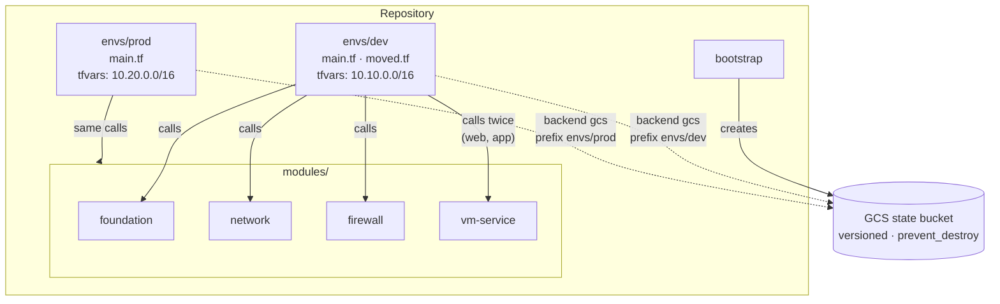

# Lesson 06 — Terraform State and Reusable Code

**Phase 2 · Beginner → Intermediate** · Builds on lesson 05 · Starts Phase 2

> Meridian's dev environment is **live**. Now leadership wants a production copy.
> Copy-pasting 300 lines of HCL into a `prod/` folder would leave two diverging
> codebases. Instead you'll turn Phase 1 into **reusable modules**, put state somewhere
> a team can share, and migrate the running dev environment **without destroying
> anything**.

## Learning objectives

- Explain what Terraform state is, what it contains, and why it must be shared, locked, versioned and protected.
- Bootstrap a GCS state bucket and configure `backend "gcs"` per environment.
- Design child modules with clear inputs and outputs, and call them from thin environment roots.
- Use `for_each` over maps of objects, `locals`, `dynamic` blocks and `optional()` object attributes.
- Refactor deployed infrastructure safely with **`moved` blocks**, and read a plan to prove nothing gets destroyed.

## 1. Concepts

### What state is

State (`terraform.tfstate`) is Terraform's record of *which real object belongs
to which resource address*:

```
google_compute_instance.web  →  projects/meridian-dev-4821/zones/us-central1-a/instances/meridian-web-1
```

Plans are a three-way comparison: **configuration** vs **state** vs (on refresh)
**reality**. State also holds every attribute, **secrets included** (database
passwords, keys), so treat it like a credential.

### Local vs remote state

| | Local file | Remote (`backend "gcs"`) |
|---|---|---|
| Team access | One laptop | Everyone with bucket access |
| Locking | None, so two applies can corrupt it | GCS backend locks automatically (a lock object) |
| History | Whatever you remember to copy | Object versioning = undo |
| Loss | Laptop dies → Terraform forgets everything | Durable, redundant storage |

**The bootstrap problem:** the state bucket is itself infrastructure. A small
`bootstrap/` configuration creates it, with local state (or migrated into the
bucket afterwards), and is applied rarely by the platform team. Protect it with
versioning, uniform access, public access prevention and
`lifecycle { prevent_destroy = true }`.

One bucket, **one prefix per environment**: `envs/dev`, `envs/prod`. Same
prefix = same state file = disaster.

### Modules

A **module** is any folder of `.tf` files. The folder you run Terraform in is the
**root module**. Folders it calls are **child modules**:

```hcl
module "network" {
  source      = "../../modules/network"   # local path, registry address, or git URL
  name_prefix = "meridian-dev"            # inputs = the module's variables
  subnets     = var.subnets
}

# outputs: module.network.subnet_ids["web"]
```

Good modules:

- do **one** job (networking, a VM workload), not "everything for team X";
- have a **small, documented interface**: every variable and output has a description and a type;
- expose IDs as outputs so callers wire modules together with **references**, never hard-coded strings;
- **don't configure providers**. The root does that, and modules inherit it.

### Repository layout used from now on

```
modules/            reusable code - no provider blocks, no tfvars
  foundation/       APIs + assets bucket
  network/          VPC + subnets (for_each)
  firewall/         rules from a map of objects
  vm-service/       service account + IAM + VM  (called twice: web, app)
envs/
  dev/              backend.tf · main.tf (module calls only) · terraform.tfvars · moved.tf
  prod/             same files, different tfvars
bootstrap/          the state bucket
```

`dev` and `prod` differ **only** in `terraform.tfvars` and backend prefix. That's the payoff.

### Loops and conditionals you'll use

| Construct | Use |
|---|---|
| `for_each = var.subnets` (map) | One instance per key, addressed `this["web"]`. Keys are stable, so removing one entry doesn't renumber the rest. |
| `count = var.enabled ? 1 : 0` | Optional single resource. **Avoid `count` for collections**: deleting item 0 shifts every index and forces replacements. |
| `dynamic "access_config" { for_each = var.external_ip ? [1] : [] }` | Optional nested block |
| `optional(number, 1000)` in an object type | Callers may omit attributes that have defaults |
| `lifecycle { prevent_destroy, create_before_destroy, ignore_changes }` | Guard rails on individual resources |

### Refactoring live infrastructure: `moved`

Moving `google_compute_instance.web` into a module changes its **address** to
`module.web.google_compute_instance.this`. To Terraform, a different address is a
different resource: *destroy the old VM, create a new one*. A `moved` block says
"same object, new name":

```hcl
moved {
  from = google_compute_instance.web
  to   = module.web.google_compute_instance.this
}
```

The plan then shows `# google_compute_instance.web has moved to module.web.google_compute_instance.this`
and `0 to destroy`. (The older imperative route is `terraform state mv`. `moved`
blocks are reviewable in a PR and apply to every copy of the state.)

## 2. How this lesson is checked offline

The checker plans **three roots**: `envs/dev`, `envs/prod` and `bootstrap`.

**Dev is planned against a real-looking deployed state**: `state/dev.tfstate`,
the lesson 05 environment "as applied", generated with `coursekit/statefab.py`.
A refactor that would destroy or recreate anything shows up exactly as it would
in a real PR. Your `backend "gcs"` block is kept in your files but swapped for
local state during the check, so nothing reaches Google Cloud.

Explore the deployed state yourself (from your workspace root):

```powershell
terraform state list -state=state/dev.tfstate
terraform show -json state/dev.tfstate > dev-state.json   # needs an initialized directory
```

## 3. Architecture



## 4. Lab files

- [lab.md](lab.md): R6.1 – R6.10 (bootstrap, modules, migrate dev, add prod)
- [challenge.md](challenge.md): C6.1 – C6.4 (module tests, provider requirements, per-environment safety)
- [broken/](broken/): "the refactor PR wants to destroy the API subnet"

```powershell
python course.py start 06              # official starter: legacy/ = lesson 05 solution
python course.py start 06 --from-mine  # your own lesson 05 work goes into legacy/
```

## 5. If this were real

The state bucket costs cents per month. Migrating real local state into it:
`terraform init -migrate-state` after adding the backend block. Terraform copies
the state up and asks first. Production has no state yet, so its first apply
creates everything: plan it, read it, apply it.
