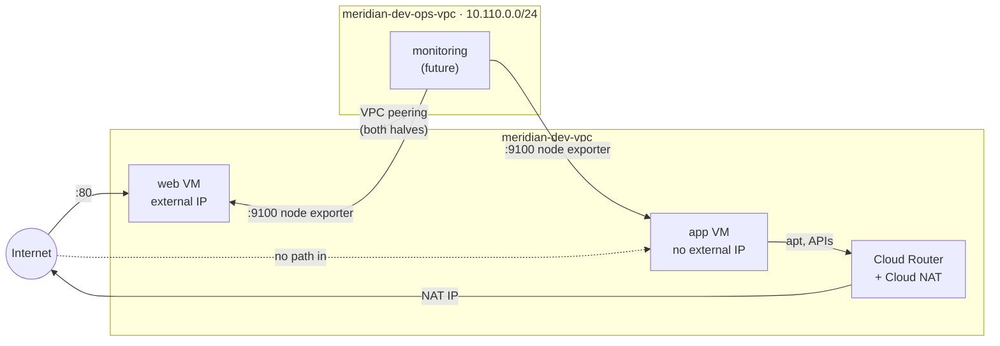

# Lesson 07 — Cloud Networking II: NAT, Peering, Private Access

**Phase 2 · Intermediate** · Builds on lesson 06

> A confession from the on-call log: **the app VM's startup script has failed on
> every boot since lesson 05.** `apt-get update` times out. The VM has no
> external IP, so it has no path to the internet. Meanwhile the ops team wants
> to run monitoring from its own network. Today you fix both, as a change to a
> live environment.

## Learning objectives

- Explain how a VM without an external IP reaches the internet (Cloud Router + Cloud NAT) and what NAT does *not* do (inbound).
- Choose NAT scope (all subnets vs a list) and IP allocation (auto vs reserved, allowlistable addresses).
- Connect two VPCs with peering: what is shared (subnet routes), what isn't (transitivity, custom routes by default), and why ranges must never overlap.
- Distinguish Private Google Access, private.googleapis.com and Private Service Connect.
- Make optional infrastructure switchable with `count = var.flag ? 1 : 0` and `one(...)`.

## 1. Concepts

### Getting out: Cloud Router + Cloud NAT

A VM's traffic to the internet needs a public source address. Without an
external IP there are two options:

| | Cloud NAT | External IP on the VM |
|---|---|---|
| Outbound | ✅ many VMs share a few NAT IPs | ✅ |
| Inbound from the internet | ❌ impossible (that's the point) | ✅ if firewalls allow |
| Attack surface | Small | Every VM is addressable |

Cloud NAT is **regional** and **software-defined**: no gateway VM, no single
point of failure. It's configured on a **Cloud Router** (the same resource that
later speaks BGP for VPNs in lesson 18). A NAT only serves VMs **in the router's
region and network**, and only the subnets it's told about:

```hcl
source_subnetwork_ip_ranges_to_nat = "ALL_SUBNETWORKS_ALL_IP_RANGES"   # simple
source_subnetwork_ip_ranges_to_nat = "LIST_OF_SUBNETWORKS"             # explicit + subnetwork blocks
```

VMs **with** an external IP ignore NAT. That's why the web VM keeps working
either way.

`nat_ip_allocate_option = "AUTO_ONLY"` lets Google pick and scale the NAT IPs.
`"MANUAL_ONLY"` with reserved `google_compute_address` resources gives fixed IPs
that a partner can allowlist.

### Talking to Google APIs privately

| Option | How | When |
|---|---|---|
| **Private Google Access** (subnet flag) | VMs without external IPs reach `*.googleapis.com` over Google's network | Always on (lesson 04 did it) |
| `private.googleapis.com` VIP `199.36.153.8/30` | Same, via a fixed address range and DNS | Lockdown with egress firewalls (lesson 05 challenge) |
| **Private Service Connect** endpoint | An internal IP *in your VPC* that fronts Google APIs | Reach APIs from on-prem or peered networks, per-endpoint control |

### Peering

VPC peering connects two VPCs (even in different projects or organizations)
so their **subnet routes** are exchanged and VMs talk over internal IPs.

- **Two halves**: each network creates a peering to the other. Until both exist, the state is `INACTIVE`.
- **No overlapping ranges.** Ever. Peering refuses to activate. This is why you planned `10.10/16` vs `10.20/16` in lesson 04.
- **Not transitive**: if A↔B and B↔C, A cannot reach C. Hub-and-spoke designs need other tools (lesson 18).
- **Firewalls still apply.** Peering creates routes, not permissions. You still need a rule allowing the ops range.
- Custom routes (static, VPN-learned) are **not** exchanged unless you export/import them explicitly.

### Optional resources with `count`

```hcl
resource "google_compute_router" "this" {
  count = var.enable_nat ? 1 : 0
  ...
}

output "nat_name" {
  value = one(google_compute_router_nat.this[*].name)   # null when count = 0
}
```

This is the right use of `count`: zero or one of something. For collections, keep using `for_each`.

## 2. How this lesson is checked offline

- **Dev is planned against the deployed lesson 06 environment** (`state/dev.tfstate`).
  The change should be **additions only**. R7.8 fails if anything is replaced or destroyed.
- The connectivity model gained two abilities:
  - **internet egress:** a VM without an external IP needs a Cloud NAT in its region and network
    that covers its subnet. Google API VIPs work through Private Google Access.
  - **internal sources:** "ops monitoring" is modelled as an address inside your ops subnet
    reaching your VMs over the peering. Peering itself is verified separately (R7.6).

## 3. Architecture



## 4. Lab files

- [lab.md](lab.md): R7.1 – R7.10
- [challenge.md](challenge.md): C7.1 – C7.4 (scoped NAT, reserved IPs, Private Service Connect, least-privilege peering)
- [broken/](broken/): "the NAT is there, but the app still can't install packages"

## 5. If this were real

Cloud NAT is billed per gateway-hour plus per GB processed, a few dollars a month
at this scale. Reserved external IPs cost money even when idle. Peering is free;
traffic across it is billed like zonal/regional internal traffic. Each PSC
endpoint has an hourly charge.
