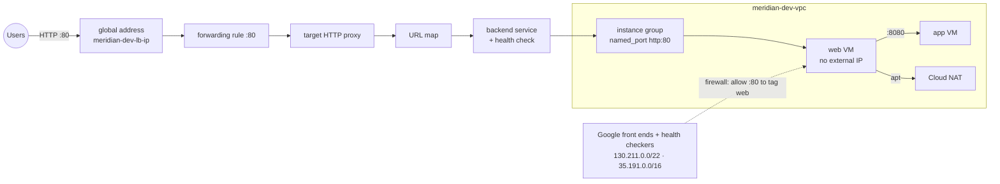

# Lesson 08 — Load Balancing and Health Checks

**Phase 2 · Intermediate** · Builds on lesson 07

> Meridian's storefront is one VM with a public IP. If it dies, the shop is down.
> To scale, it's one VM with nowhere to add a second. And every scanner on the
> internet can hit it directly. Today the web tier moves **behind a global load
> balancer**, and its public IP goes away.

## Learning objectives

- Name every resource in a Google Cloud external Application Load Balancer and how they connect.
- Write health checks that reflect real health, with sensible intervals, timeouts and thresholds.
- Open firewalls for Google's front ends and health checkers, and close direct access.
- Remove a VM's public IP safely, keeping its egress through Cloud NAT.
- (Challenge) Serve HTTPS with a Google-managed certificate and redirect HTTP.

## 1. Concepts

### The load balancer is a chain, not a box

In the console it looks like one thing. In the API, and therefore in Terraform,
it's six or seven resources:

```
global address ─► forwarding rule ─► target HTTP(S) proxy ─► URL map ─► backend service ─► instance group ─► VMs
 (the public IP)   (IP + port)        (terminates HTTP/TLS)   (routing)   (balancing,        (which VMs,
                                                                           health checks)     which port)
```

| Resource | Why it exists |
|---|---|
| `google_compute_global_address` | A reserved anycast IP. Without it, re-creating the forwarding rule changes your IP and breaks DNS. |
| `google_compute_global_forwarding_rule` | "Traffic to this IP on this port goes to this proxy." One per port (80, 443). |
| `google_compute_target_http_proxy` / `_https_proxy` | Terminates the client connection. HTTPS proxies hold certificates. |
| `google_compute_url_map` | Routes by host and path (`/api/*` → API backend), or redirects. |
| `google_compute_backend_service` | Picks a healthy backend. Owns health checks, timeouts, logging, draining, CDN and Cloud Armor (lesson 19). |
| `google_compute_instance_group` | A list of VMs in one zone, plus **named ports** (`http → 80`). |
| `google_compute_health_check` | Probes each VM. Unhealthy VMs get no traffic. |

`load_balancing_scheme = "EXTERNAL_MANAGED"` selects the current global external
Application Load Balancer (Envoy-based). `"EXTERNAL"` is the classic one.

### Named ports

The backend service says `port_name = "http"`. The instance group says
`named_port { name = "http"  port = 80 }`. If the names don't match, the load
balancer doesn't know which port to use, and every request fails.

### Health checks

```hcl
check_interval_sec  = 10   # probe every 10 s
timeout_sec         = 5    # must be <= interval
healthy_threshold   = 2    # 2 successes to (re)join
unhealthy_threshold = 3    # 3 failures to be ejected (1 = flapping on one slow response)
```

Probe a path that reflects real health (`/healthz` that checks dependencies),
on the port that serves traffic.

### Who connects to your VMs now

The load balancer doesn't forward client IPs at the network layer. Connections to
your VMs come from **Google's front ends and health checkers**:

```
130.211.0.0/22   35.191.0.0/16
```

So the web firewall rule changes from "anyone on port 80" to "these two ranges
on port 80". **Forget one range and health checks fail intermittently.** That's
the broken repo.

### Dropping the public IP

The web VM no longer needs an external IP: inbound traffic comes from the load
balancer, and outbound (`apt-get`) goes through the Cloud NAT from lesson 07. With
the `dynamic "access_config"` block in `vm-service`, it's `external_ip = false`.
The provider removes the access config **in place**, without recreating the VM.

## 2. How this lesson is checked offline

- **Dev is planned against the deployed lesson 07 environment.** The expected plan is
  **8 to add, 1 to change, 1 to destroy**: the load balancer, the new firewall rule,
  the web VM losing its public IP (in place), and the old public rule going away.
  R8.8 allows deleting firewall rules but nothing else, and no replacements.
- `coursekit/lb.py` traces the chain from forwarding rule to VM and reports the first
  broken link: a missing named port, a URL map without a backend, a group without the web VM.
- The connectivity model checks traffic **from** `35.191.0.10` and `130.211.0.10` to your VMs.

## 3. Architecture



## 4. Lab files

- [lab.md](lab.md): R8.1 – R8.10
- [challenge.md](challenge.md): C8.1 – C8.4 (HTTPS, redirect, logging and draining, module test)
- [broken/](broken/): "the backend keeps flapping between healthy and unhealthy"

## 5. If this were real

A global forwarding rule is billed hourly (about $18/month for the first five
rules) plus data processed. Google-managed certificates are free, but they only
provision once DNS points at the load balancer IP, which can take up to an hour.
The reserved address is free while in use.
