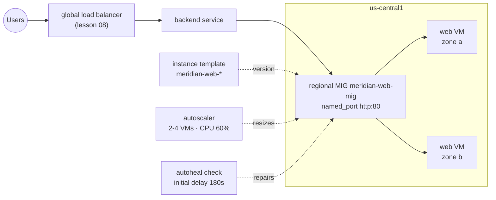

# Lesson 09 — Autoscaling and Instance Management

**Phase 2 · Intermediate** · Builds on lesson 08

> The load balancer is in place, but behind it is still **one VM in one zone**.
> A kernel panic, a zone outage or a traffic spike takes the shop down, and
> every update means downtime. Today the web tier becomes a **fleet**: built from
> a template, spread across zones, resized by an autoscaler, and repaired automatically.

## Learning objectives

- Explain instance templates and why they are immutable (`name_prefix` + `create_before_destroy`).
- Build a regional managed instance group (MIG) and explain zonal vs regional MIGs.
- Configure autoscaling signals, bounds and cooldowns, and reason about headroom.
- Set up autohealing with a realistic grace period, separate from load balancer health.
- Roll out new templates without losing capacity (`max_surge`, `max_unavailable = 0`).
- Migrate a running service from a single VM to a MIG, and read that plan.

## 1. Concepts

### From pets to cattle

| | Single VM (lessons 03–08) | Managed instance group |
|---|---|---|
| Created by | Terraform, one resource | The MIG, from a template |
| Fails | Stays broken until someone notices | Autohealing recreates it |
| Load spike | Slow, then down | Autoscaler adds VMs |
| Update | Edit in place, or replace with downtime | Rolling replacement, capacity kept |
| Zone outage | Down | Survivors in other zones keep serving |

### Instance templates

A template is the recipe: machine type, image, disk, network, metadata,
service account. Templates **can't be modified**. Any change creates a new
one. So:

```hcl
resource "google_compute_instance_template" "this" {
  name_prefix = "meridian-web-"          # Terraform appends a unique suffix
  ...
  lifecycle {
    create_before_destroy = true         # new template exists before the MIG lets go of the old one
  }
}
```

With a fixed `name`, Terraform would have to delete the old template first, but
the MIG still uses it, so the apply fails.

### Regional MIGs

A **zonal** MIG lives in one zone. A **regional** MIG spreads instances across
`distribution_policy_zones` and rebalances if a zone fails. It exposes an
`instance_group` URL that the backend service uses, with the same `named_port` contract as lesson 08.

### Autoscaling

```hcl
autoscaling_policy {
  min_replicas    = 2      # never 1: a single failure or rollout = outage
  max_replicas    = 4      # a cost guard rail
  cooldown_period = 90     # ignore metrics from VMs still booting
  cpu_utilization { target = 0.6 }
}
```

Why 0.6 and not 0.9? New VMs take a minute or two to boot and run the startup
script. The headroom absorbs the spike in the meantime.

### Autohealing vs load balancer health

Both use health checks, but they answer different questions:

- **Load balancer**: "Should this VM receive traffic *right now*?" Fast and strict.
- **Autohealing**: "Is this VM broken enough to *delete and recreate*?" Slower and more tolerant,
  with an `initial_delay_sec` that covers boot plus the startup script.

Get `initial_delay_sec` wrong and the MIG recreates new VMs before they ever
become healthy: an endless loop (the broken repo).

### Rolling updates

```hcl
update_policy {
  type                  = "PROACTIVE"   # roll out as soon as the template changes
  minimal_action        = "REPLACE"
  max_surge_fixed       = 2             # create up to 2 extra VMs during the rollout (>= #zones for regional MIGs)
  max_unavailable_fixed = 0             # never take a serving VM away first
}
```

### Migrating the live service

The service account and IAM grants already exist in the deployed state as
`module.web.google_service_account.this` and `module.web.google_project_iam_member.this`.
If the new module keeps **the same resource names** and module name, those
addresses don't change and Terraform leaves them alone. Only the VM and its
unmanaged instance group are replaced by the template, MIG and autoscaler.

## 2. How this lesson is checked offline

- **Dev is planned against the deployed lesson 08 environment.** Expected:
  **4 to add, 1 to change, 2 to destroy**. The adds are the template, MIG, autoscaler and
  autohealing check. The change is the backend service switching groups in place. The destroys are
  the old web VM and its unmanaged group. R9.8 fails on any other deletion or any replacement.
- Web VMs don't exist as resources any more, so connectivity checks treat the
  **instance template** as the web VM. It has the same tags, subnet and service account.
- `coursekit` now follows references **through module inputs and outputs**
  (`module.web.instance_group` → `var.instance_groups` → backend), so the load balancer
  trace works even before anything exists.

## 3. Architecture



## 4. Lab files

- [lab.md](lab.md): R9.1 – R9.10
- [challenge.md](challenge.md): C9.1 – C9.4 (scale-in control, schedules, load-balancer signal, validated bounds)
- [broken/](broken/): "the MIG keeps recreating VMs and none ever becomes healthy"

## 5. If this were real

You pay for the VMs the autoscaler runs. dev runs at least 2 e2-micro VMs, prod at least 3. MIGs,
templates, autoscalers and health checks are free. Test autohealing by stopping
NGINX on one VM (`sudo systemctl stop nginx`) and watching it get recreated.
