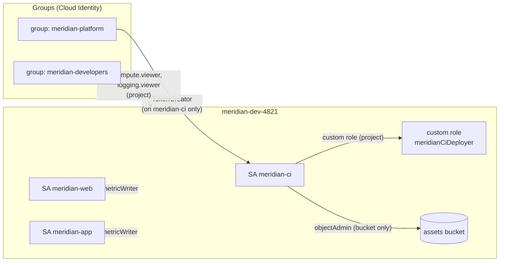

# Lesson 10 — Identity and Access Management

**Phase 2 · Intermediate** · Builds on lesson 09

> A security audit of the dev project came back with five findings. They all
> live in one file, `envs/dev/legacy-access.tf`, created by hand during a launch
> rush and imported later: a CI service account with **Editor**, a downloaded
> **JSON key**, an **authoritative binding**, and a departed contractor who is
> still **Owner**. Today you replace that file with identities that have exactly the
> access they need, and no keys at all.

## Learning objectives

- Read an IAM policy as *principal → role → resource*, at project, service-account and bucket level.
- Replace basic roles with predefined and **custom** roles built from explicit permissions.
- Use **resource-level IAM** (a bucket, a service account) instead of project-wide grants.
- Eliminate service account keys with **impersonation**, and (challenge) **Workload Identity Federation**.
- Give humans access through **groups**, never individuals.
- Clean up deployed IAM safely: keep the identities, delete only the bad grants.

## 1. Concepts

### Where a grant lives decides how far it reaches

| Resource | Grants access to | Example |
|---|---|---|
| `google_project_iam_member` | Everything of that kind in the project | logWriter for the web SA |
| `google_storage_bucket_iam_member` | One bucket | CI may write objects to the assets bucket only |
| `google_service_account_iam_member` | One service account | the platform group may impersonate CI only |

Prefer the **narrowest** resource that works. `roles/storage.objectAdmin` on the
project reaches every bucket, including the Terraform state bucket.

### Role types

| | Example | Use |
|---|---|---|
| Basic | `roles/editor` | Never, for anything. Thousands of permissions. |
| Predefined | `roles/compute.viewer` | Most needs. Google maintains them. |
| Custom | `projects/p/roles/meridianCiDeployer` | When predefined roles are too broad: an explicit permission list. |

```hcl
resource "google_project_iam_custom_role" "deployer" {
  role_id     = "meridianCiDeployer"
  title       = "Meridian CI deployer"
  permissions = ["compute.instanceGroupManagers.update", "compute.instanceTemplates.useReadOnly", ...]
}
```

Never put `iam.*`, `resourcemanager.*`, `*.setIamPolicy` or wildcards in a
workload's role. Those let the role grant itself more.

### Member vs binding vs policy (again)

Lesson 02 warned about this. The audit shows why: the legacy
`google_project_iam_binding` for `roles/logging.logWriter` lists only the web
SA. Applying it would **remove** the app SA's logWriter grant. When you delete
the binding, the `_member` grants from lessons 02–09 keep working.

### No keys

A service account key is a password that never expires, can't be scoped, and
gets copied. The alternatives:

| Who | How | What it looks like |
|---|---|---|
| A human or script | **Impersonation**: `roles/iam.serviceAccountTokenCreator` *on the account* | `gcloud ... --impersonate-service-account=meridian-ci@...`, or `impersonate_service_account` in the provider |
| GitHub Actions / other clouds | **Workload Identity Federation**: the CI's own OIDC token is exchanged for a short-lived Google token | challenge C10.1 |
| VMs, Cloud Run | The attached service account | lessons 03–09 |

Grant `serviceAccountTokenCreator` or `serviceAccountUser` **on the specific
account**, never at project level. A project-level grant can impersonate
*every* service account, including ones with more power than yours.

### Humans through groups

`user:sam@...` grants outlive employment. `group:meridian-developers@...` grants
follow team membership, managed in Cloud Identity / Workspace, with no Terraform
change when people join or leave.

## 2. How this lesson is checked offline

- **Dev is planned against the deployed environment including `legacy-access.tf`.**
  The expected plan is **6 to add, 4 to destroy**, plus one move: the four bad
  grants and the key go, and the CI account is **moved** into the new module (lesson 06
  skills) because the CI system already knows its identity.
- `coursekit/iam.py` builds the effective grant list: project, bucket and
  service-account level, member/binding/policy style, with custom roles expanded to
  permissions. Checks ask questions like "what can `meridian-ci` do, and where?"

## 3. Architecture



## 4. Lab files

- [lab.md](lab.md): R10.1 – R10.10
- [challenge.md](challenge.md): C10.1 – C10.4 (Workload Identity Federation, expiring access, org policy, validated permissions)
- [broken/](broken/): "the security scanner says the platform team can become any service account"

## 5. If this were real

IAM is free. The cost of getting it wrong isn't. Before deleting a key in
production, find who uses it: Cloud Audit Logs and the key's
`last authenticated` time in the console. Disable it first, wait, then delete.
