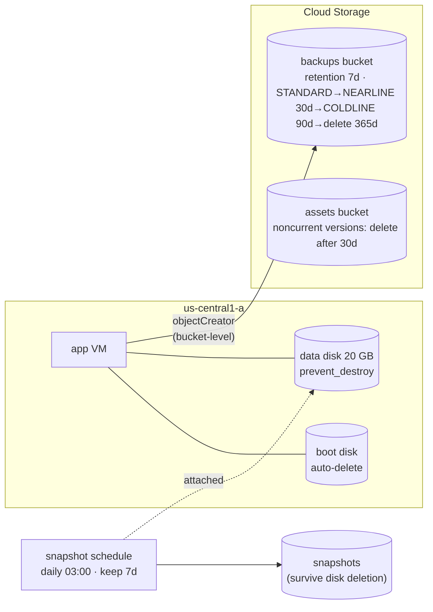

# Lesson 11 — Cloud Storage and Persistent Data

**Phase 2 · Intermediate** · Builds on lesson 10 · **Phase 2 capstone**

> Meridian's API is about to store real data: order exports today, a database
> in lesson 12. Right now everything lives on a boot disk that disappears with
> the VM, and there are no backups. Today you give the app tier **durable storage**,
> **automatic snapshots**, and a **backups bucket** nobody can quietly empty.

## Learning objectives

- Separate data from compute: persistent disks that outlive VMs.
- Schedule snapshots with resource policies, and keep them when a disk is deleted.
- Attach resources to running VMs without recreating them, and manage the perpetual-diff trap with `ignore_changes`.
- Choose storage classes and write lifecycle rules that move data to cheaper tiers.
- Protect backups with retention policies, and know when *not* to lock them.
- Use `prevent_destroy` on resources whose loss would be a data incident.

## 1. Concepts

### Disks outlive VMs, if you let them

| | Boot disk | Separate `google_compute_disk` |
|---|---|---|
| Lifetime | Deleted with the VM (`auto_delete`) | Independent |
| Recreate the VM (new image, startup script) | Data gone | Detach, recreate, re-attach |
| Snapshots | Possible, but mixed with OS | Clean, data-only |

Disks are **zonal**: a disk can only attach to a VM in the same zone.
(Regional persistent disks replicate across two zones. Lesson 21.)

### Attaching without recreating

Changing an instance's `attached_disk` block works, but a separate
`google_compute_attached_disk` resource leaves the deployed instance alone.
The catch: now **two resources manage the same setting**. The instance sees an
attachment it didn't declare and plans to remove it on every run. The fix is to
tell the instance to ignore it:

```hcl
lifecycle {
  ignore_changes = [attached_disk]
}
```

### Things that recreate a VM

Some instance arguments are **ForceNew**: changing them destroys and recreates
the VM. `metadata_startup_script` is one of them. Editing `app-startup.sh` to
format the new disk would replace the app VM. Use `metadata = { startup-script = ... }`
(updatable in place), configuration management, or a new image instead.
The checker catches it: R11.8.

### Snapshots

```hcl
resource "google_compute_resource_policy" "snapshots" {
  snapshot_schedule_policy {
    schedule { daily_schedule { days_in_cycle = 1  start_time = "03:00" } }
    retention_policy {
      max_retention_days    = 7
      on_source_disk_delete = "KEEP_AUTO_SNAPSHOTS"   # backups survive the disk
    }
  }
}
```

Attach it with `google_compute_disk_resource_policy_attachment`. Snapshots are
incremental: you pay for changed blocks, not 7 full copies.

### Storage classes and lifecycle

| Class | Min. storage duration | Use |
|---|---|---|
| STANDARD | none | Hot data, website assets |
| NEARLINE | 30 days | Accessed about monthly |
| COLDLINE | 90 days | About quarterly |
| ARCHIVE | 365 days | Compliance archives |

Lifecycle rules move objects down the tiers by age and delete them at the end.
Moving to Nearline before 30 days still bills the full 30.

### Retention policies

A **retention policy** blocks deleting or overwriting objects younger than the
retention period, even for Owners. Combined with uniform access and public access
prevention, it makes a backups bucket resistant to accidents and to an attacker
with stolen credentials.

- Retention can't be combined with Object Versioning (retention already prevents overwrites).
- **Locking** (`is_locked = true`) is **permanent**: the policy can never be shortened or removed, and the bucket
  can't be deleted until every object ages out. Lock only where compliance requires it (challenge: prod).

## 2. How this lesson is checked offline

**Dev is planned against the deployed lesson 10 environment.** Expected: **6 to add, 1 to change,
0 to destroy**:

- **Adds:** data disk, attachment, snapshot policy and its attachment, backups bucket, the app's bucket grant.
- **Change:** the assets bucket gains a lifecycle rule, in place.

R11.8 fails on any replacement. Editing the startup script would replace the app VM, and there is a
fixture proving the check catches it. `lifecycle` blocks aren't in plan JSON, so `prevent_destroy`
and `ignore_changes` are checked by reading your HCL.

## 3. Architecture



## 4. Lab files

- [lab.md](lab.md): R11.1 – R11.10
- [challenge.md](challenge.md): C11.1 – C11.4 (locked retention, dual-region backups, multi-region snapshots, validated disk size)
- [broken/](broken/): "every apply detaches the data disk"

## 5. Phase 2 complete

Meridian now has reusable modules, remote state, private networking with NAT and peering, a global
load balancer, an autoscaling, self-healing fleet, least-privilege IAM without keys, and durable,
backed-up storage. Phase 3 builds cloud-native services on this foundation, starting with a managed
database.

## 6. If this were real

A 20 GB pd-balanced disk costs a couple of dollars a month. Snapshots are incremental and cheap.
Coldline costs a fraction of Standard per GB, but retrieval is charged. Lifecycle rules only pay off
for data that really is cold.
