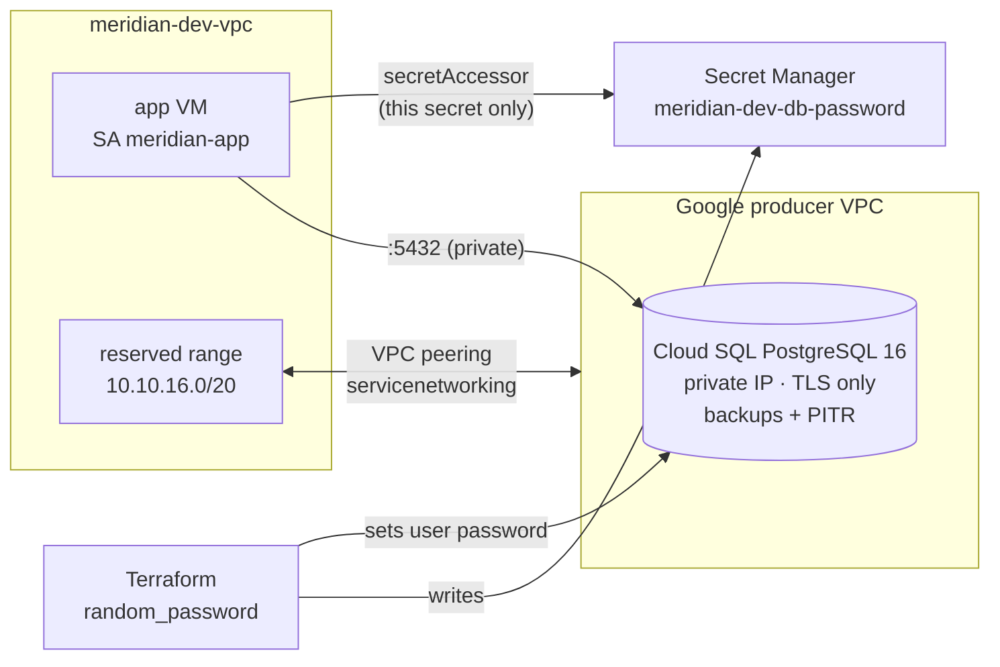

# Lesson 12 — Databases and Data Infrastructure

**Phase 3 · Intermediate** · Builds on lesson 11 · Starts Phase 3

> Meridian's API has been serving a static JSON file. Real orders need a real
> database. Today the app tier gets a **private PostgreSQL** on Cloud SQL: no
> public IP, credentials nobody has ever seen, daily backups with point-in-time
> recovery, and protection against the worst `terraform destroy` of your career.

## Learning objectives

- Connect managed services to your VPC with **Private Service Access** (PSA).
- Provision Cloud SQL for PostgreSQL with private IP only, TLS, backups and PITR.
- Generate credentials in Terraform and keep them in **Secret Manager**, out of outputs, tfvars and logs.
- Grant access at the narrowest scope: one secret, one role.
- Choose availability (ZONAL vs REGIONAL) and tiers per environment.
- Protect stateful resources at two levels: Terraform (`deletion_protection`) and the API.

## 1. Concepts

### Where does a managed database live?

Cloud SQL instances run in a **Google-owned VPC** (the "service producer").
To give one a private IP in *your* network:

```
your VPC  ──VPC peering (servicenetworking)──►  Google's producer VPC  ─── Cloud SQL instance
   ▲
   └─ google_compute_global_address (purpose = VPC_PEERING) reserves 10.10.16.0/20 for it
```

1. Reserve an internal range in your VPC that no subnet uses.
2. `google_service_networking_connection` peers it with `servicenetworking.googleapis.com`.
3. The instance's `private_network` is your VPC. It gets an IP from the reserved range.

Plan the range like any other (lesson 04): it must never overlap subnets,
peers (lesson 07) or on-prem ranges.

### Private IP only

```hcl
ip_configuration {
  ipv4_enabled    = false               # no public IP, not even an unused one
  private_network = var.network_id
  ssl_mode        = "ENCRYPTED_ONLY"
}
```

`authorized_networks = ["0.0.0.0/0"]` "just for a quick test" is one of the most
common causes of database breaches. That's the broken repo.

### Backups and point-in-time recovery

Daily backups restore to last night. **PITR** replays the write-ahead log and
restores to *any second* in the retention window. That's the difference between
losing a day of orders and losing none.

### Credentials without humans

```hcl
resource "random_password" "app" { length = 32 }

resource "google_sql_user" "app"                       { password    = random_password.app.result }
resource "google_secret_manager_secret_version" "pw"   { secret_data = random_password.app.result }
```

- Nobody types, sees or emails the password. The app reads it from Secret Manager with its own identity.
- **Never output it**, not even with `sensitive = true`. Outputs are stored in state, shown in CI logs and passed between configurations.
- **Never put it in tfvars.** tfvars get committed.
- The password *is* in the Terraform state, as is every attribute. That's why the state bucket (lesson 06) is locked down.

### Availability

| | ZONAL | REGIONAL |
|---|---|---|
| Setup | One instance | Primary + synchronous standby in another zone |
| Zone failure | Down until the zone recovers | Automatic failover (~1 minute) |
| Cost | 1× | ~2× |
| Meridian | dev | prod |

Shared-core tiers (`db-f1-micro`, `db-g1-small`) have no SLA. Use them for dev only.

## 2. How this lesson is checked offline

**Dev is planned against the deployed lesson 11 environment.** Expected: **13 to add, 0 to change,
0 to destroy**: APIs, the PSA range and connection, the instance, database, user, password, secret
and its version, the secret-level grant, and the app's `cloudsql.client` role.

Checks follow outputs **through modules** to catch a password leaking via
`module.db.password`, and scan every `.tfvars` file for credentials.

## 3. Architecture



## 4. Lab files

- [lab.md](lab.md): R12.1 – R12.10
- [challenge.md](challenge.md): C12.1 – C12.4 (slow-query logging, IAM database auth, secret residency, validated HA)
- [broken/](broken/): "I just opened it up for a minute to connect from home"

## 5. If this were real

A `db-g1-small` zonal instance costs roughly $25–30/month. A REGIONAL `db-custom-2-7680`
is several hundred. Secret Manager costs cents. Creating a Cloud SQL instance takes
5–10 minutes. Instance names can't be reused for about a week after deletion,
another reason for `deletion_protection`.
