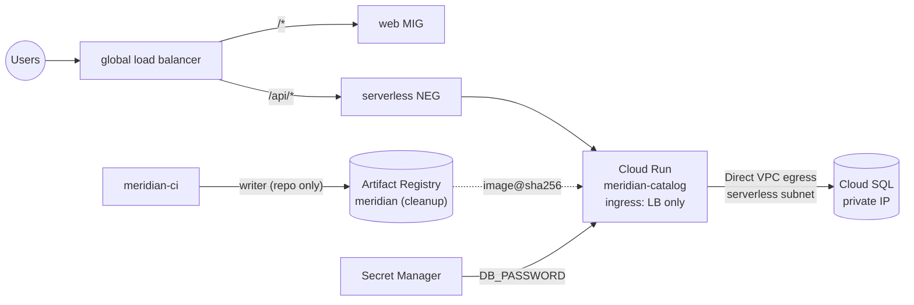

# Lesson 13 — Serverless Infrastructure

**Phase 3 · Intermediate** · Builds on lesson 12

> Meridian's product catalog is read-heavy, spiky and stateless: perfect for
> serverless. Instead of another VM fleet, the new **catalog API runs on Cloud
> Run**. It scales to zero at night, reads the database over private networking,
> and is reachable only through the existing load balancer at `/api/*`.

## Learning objectives

- Store container images in Artifact Registry with cleanup policies and repository-level access.
- Deploy a Cloud Run service with its own identity, bounded scaling and resource limits.
- Pin images **by digest** so every deploy runs exactly the bytes you reviewed.
- Lock down ingress so only the load balancer can reach a service.
- Connect Cloud Run to private resources with **Direct VPC egress**, and inject secrets from Secret Manager.
- Route a path on an existing load balancer to a serverless backend through a **serverless NEG**.

## 1. Concepts

### Artifact Registry

A regional, private registry: `us-central1-docker.pkg.dev/<project>/meridian/<image>`.
Images pile up with every build. Cleanup policies keep the registry, and the bill, small:

| Policy | Effect |
|---|---|
| `DELETE` untagged older than 30 days | superseded builds go away |
| `KEEP` the 10 most recent versions | always something to roll back to |

Grant `roles/artifactregistry.writer` **on the repository** to CI only.

### Tags vs digests

`catalog:latest` and `catalog:v1.4` are **mutable labels**. Anyone with push access can
move them to different bytes. `catalog@sha256:4f4f…` names one exact image forever.
Pin production deployments by digest; CI resolves tag → digest when it builds.

### A locked-down Cloud Run service

```hcl
resource "google_cloud_run_v2_service" "this" {
  ingress              = "INGRESS_TRAFFIC_INTERNAL_LOAD_BALANCER"   # *.run.app is unreachable from the internet
  invoker_iam_disabled = true                                       # the load balancer is the only way in, so no allUsers binding

  template {
    service_account = google_service_account.this.email             # never the default compute SA
    scaling { min_instance_count = 0  max_instance_count = 5 }
    containers { image = "...@sha256:..."  resources { limits = { cpu = "1", memory = "512Mi" } } }
  }
}
```

| Ingress | Who can reach the service |
|---|---|
| `INGRESS_TRAFFIC_ALL` | Anyone on the internet, via `*.run.app` |
| `INGRESS_TRAFFIC_INTERNAL_LOAD_BALANCER` | Your load balancers and VPC |
| `INGRESS_TRAFFIC_INTERNAL_ONLY` | Only from your VPC |

`allUsers` with `roles/run.invoker` plus `INGRESS_TRAFFIC_ALL` means a public
endpoint that skips everything you put in front of it. That's the broken repo.

### Direct VPC egress

Cloud SQL lives on a private IP (lesson 12). Cloud Run reaches it through **Direct VPC egress**:
instances get IPs from a subnet you dedicate to them.
`egress = "PRIVATE_RANGES_ONLY"` sends only RFC 1918 traffic through the VPC; everything
else goes straight out.

### Secrets as environment variables

```hcl
env {
  name = "DB_PASSWORD"
  value_source { secret_key_ref { secret = "meridian-dev-db-password"  version = "latest" } }
}
```

The service account needs `secretAccessor` on **that** secret. A plain `value = "..."`
would show up in the console, the revision history and the plan.

### Serverless NEG

A load balancer reaches Cloud Run through a **serverless network endpoint group**
(`google_compute_region_network_endpoint_group`, type `SERVERLESS`). It becomes the
backend of a backend service, and a URL map `path_rule` sends `/api/*` to it.
There are no health checks or named ports: Cloud Run handles both.

## 2. How this lesson is checked offline

**Dev is planned against the deployed lesson 12 environment.** Expected: **10 to add, 1 to change,
0 to destroy**. The change is the URL map gaining the `/api/*` route. Checks follow the route from
the URL map through the backend service and the NEG to the Cloud Run service, and confirm the
default route still reaches the web MIG.

## 3. Architecture



## 4. Lab files

- [lab.md](lab.md): R13.1 – R13.10
- [challenge.md](challenge.md): C13.1 – C13.4 (canary traffic split, health probes, release retention, image validation)
- [broken/](broken/): "the frontend team needed a URL to test against"

## 5. If this were real

With `min_instance_count = 0` and `cpu_idle = true`, an idle Cloud Run service costs
nothing. prod keeps one warm instance (a few dollars a month) to avoid cold starts.
Artifact Registry charges per GB stored, which is why cleanup policies matter.
