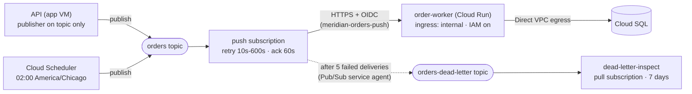

# Lesson 14 — Event-Driven Architecture

**Phase 3 · Intermediate** · Builds on lesson 13

> When an order is placed, five things must happen: payment capture, stock
> reservation, a confirmation email, analytics, and a nightly reconciliation.
> Doing all of that inside the API request makes checkout slow and fragile. Today
> the API **publishes an event** and returns. A private worker processes it
> reliably, with retries, and failures that can't be processed land in a
> **dead-letter queue** instead of vanishing.

## Learning objectives

- Model asynchronous work with Pub/Sub topics and push subscriptions.
- Authenticate push delivery with OIDC tokens and a dedicated identity, and keep the worker private.
- Configure retries, backoff, acknowledgement deadlines and dead-lettering, and grant the permissions dead-lettering needs.
- Publish scheduled events with Cloud Scheduler in an explicit time zone.
- Reuse a module for a new kind of service, and handle the address changes that causes.

## 1. Concepts

### Topics, subscriptions, push

```
publisher ──► topic ──► subscription ──push (HTTPS + OIDC)──► worker
                    └─► another subscription ──► another consumer
```

A **topic** fans out to every subscription. A **push subscription** POSTs each
message to an HTTPS endpoint and expects a 2xx within `ack_deadline_seconds`.
Anything else counts as a failed delivery.

With `oidc_token`, every push carries a Google-signed token for a service account
you choose. The worker (Cloud Run with IAM on) only accepts requests from that
account's tokens. Pub/Sub push counts as **internal** traffic, so the worker can use
`INGRESS_TRAFFIC_INTERNAL_ONLY`.

### When processing fails

| Setting | Why |
|---|---|
| `retry_policy { minimum_backoff = "10s"  maximum_backoff = "600s" }` | Back off exponentially instead of hammering a struggling worker |
| `dead_letter_policy { dead_letter_topic  max_delivery_attempts = 5 }` | After 5 failures, move the message aside: a "poison message" no longer blocks or burns money |
| a subscription **on the dead-letter topic** | Messages published to a topic with no subscription are dropped |
| `expiration_policy { ttl = "" }` | By default, a subscription with no activity for 31 days is **deleted** |

Dead-lettering is performed by Google's **Pub/Sub service agent**
(`service-<project number>@gcp-sa-pubsub.iam.gserviceaccount.com`). It needs:

- `roles/pubsub.publisher` on the **dead-letter topic**, to put the message there;
- `roles/pubsub.subscriber` on the **source subscription**, to remove it from there.

Without them, dead-lettering silently doesn't happen. That's the broken repo.

### At-least-once delivery

Pub/Sub delivers every message **at least once**. Duplicates happen (retries,
redeliveries after a timeout). Workers must be **idempotent**: processing order 123
twice must have the same effect as processing it once.

### Reusing the Cloud Run module, and Terraform addresses

The worker reuses `cloud-run-service` from lesson 13, but needs no load balancer,
so the NEG gets `count = var.create_neg ? 1 : 0`. That changes the deployed
catalog NEG's address from `...this` to `...this[0]`.

**Terraform infers that one move by itself**: adding `count` to a resource turns the
existing object into instance `[0]`. The solution still writes an explicit `moved`
block, to document it. Terraform does **not** infer renames, module moves or
`for_each` keys. Switching the NEG to `for_each` would recreate it, and the `/api`
route would break mid-apply. A fixture proves it: R14.8.

## 2. How this lesson is checked offline

**Dev is planned against the deployed lesson 13 environment.** Expected:
**16 to add, 0 to change, 0 to destroy**, plus
`module.catalog...network_endpoint_group.this has moved to ...this[0]`.
`coursekit/iam.py` now reads topic- and subscription-level grants, so the checks can
confirm that the service agent's dead-letter permissions are in place.

## 3. Architecture



## 4. Lab files

- [lab.md](lab.md): R14.1 – R14.10
- [challenge.md](challenge.md): C14.1 – C14.4 (schemas, replay, filters, validated attempts)
- [broken/](broken/): "failed orders retry forever and the dead-letter queue is always empty"

## 5. If this were real

Pub/Sub's first 10 GB per month are free. Meridian's order volume costs nothing.
Cloud Scheduler gives three free jobs per billing account. The worker scales to zero.
