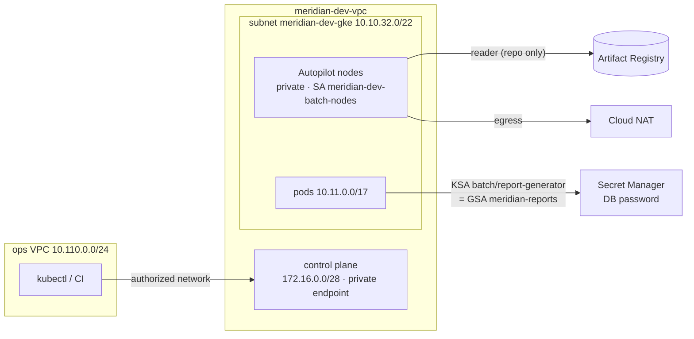

# Lesson 15 — Containers and Kubernetes (GKE)

**Phase 3 · Intermediate** · Builds on lesson 14

> Finance wants nightly sales reports, inventory forecasts and a data export:
> containerized batch jobs that run for minutes to hours. They don't fit Cloud
> Run's request model, and nobody wants to babysit VMs for them. Today Meridian
> gets a **private GKE Autopilot cluster**. The focus is on what Terraform owns:
> the network, the cluster's security posture and its identities. Kubernetes
> manifests are out of scope.

## Learning objectives

- Plan VPC-native IP space: node, pod and service ranges that never collide.
- Provision a regional Autopilot cluster with private nodes and a private control plane.
- Restrict Kubernetes API access with master authorized networks.
- Replace node credentials with **Workload Identity**, bound to one Kubernetes service account.
- Run nodes as a dedicated, minimal service account.
- Choose release channels and maintenance windows per environment.

## 1. Concepts

### Autopilot vs Standard

| | Autopilot | Standard |
|---|---|---|
| Nodes | Google provisions, scales, patches | You manage node pools |
| Billing | Per pod resource request | Per node |
| Hardening | Enforced (no privileged pods, Shielded nodes, Workload Identity on) | Your job |
| Meridian | ✅ batch jobs | When you need GPUs, custom kernels, DaemonSets |

### VPC-native IP planning

Every pod and every Service gets an IP from a **secondary range** on the node subnet:

```
subnet  meridian-dev-gke   10.10.32.0/22   nodes   (1,020 IPs)
  └─ pods                  10.11.0.0/17    pods    (32,768 IPs; Autopilot reserves a /24 per node)
  └─ services              10.11.128.0/22  Services (1,024 IPs)
control plane              172.16.0.0/28   Google-managed endpoint in your VPC
```

These ranges join the "never overlap" list from lessons 04, 07 and 12: subnets,
peers, the PSA range, and the other environment's ranges. Pod ranges are large, so
plan them early.

### Private by default

```hcl
private_cluster_config {
  enable_private_nodes    = true   # nodes: internal IPs only (egress via Cloud NAT, lesson 07)
  enable_private_endpoint = true   # control plane: no public endpoint
}
master_authorized_networks_config {
  cidr_blocks { display_name = "tools"  cidr_block = "10.110.0.0/24" }   # the peered ops VPC
}
```

A public control plane with `0.0.0.0/0` authorized means anyone on the internet can
try every Kubernetes and authentication vulnerability against your cluster. That's
the broken repo.

### Workload Identity

Pods shouldn't use the node's identity, and shouldn't carry key files. With
Workload Identity, a Kubernetes service account (KSA) acts as a Google service
account (GSA):

```hcl
member = "serviceAccount:meridian-dev-4821.svc.id.goog[batch/report-generator]"
role   = "roles/iam.workloadIdentityUser"     # on the GSA meridian-reports
```

Only pods running as `report-generator` in namespace `batch` get `meridian-reports`'s
permissions: here, reading the DB password secret. Nothing else.

### Node identity

Nodes still need an identity for logging, monitoring and pulling images. Give them a
dedicated SA with `roles/container.defaultNodeServiceAccount`, plus
`artifactregistry.reader` **on the Meridian repository**, not the default compute
service account, which has Editor.

### Upgrades

Release channels decide *which* versions you get: RAPID, REGULAR, or STABLE.
Maintenance windows decide *when*. Meridian: dev on REGULAR, so it sees new versions
first; prod on STABLE. Both upgrade only at weekends.

## 2. How this lesson is checked offline

**Dev is planned against the deployed lesson 14 environment.** Expected: **9 to add, 0 to change, 0 to destroy**.
R15.9 also fails if any *existing* subnet is merely updated. The new `dynamic "secondary_ip_range"`
block must leave the web, app and serverless subnets untouched. R15.2 checks every primary and
secondary range, the PSA range and the control-plane range for overlaps.

## 3. Architecture



## 4. Lab files

- [lab.md](lab.md): R15.1 – R15.10
- [challenge.md](challenge.md): C15.1 – C15.4 (Binary Authorization, vulnerability scanning, cost allocation, validated networks)
- [broken/](broken/): "we just wanted kubectl from home"

## 5. If this were real

Autopilot charges a cluster management fee (about $73/month, with one zonal or
Autopilot cluster per billing account free) plus pod resources while jobs run. An
idle Autopilot cluster with no pods costs only the fee. Creating a cluster takes
5–10 minutes.
