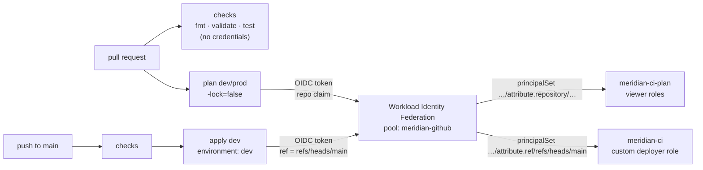

# Lesson 16 — CI/CD and Terraform Automation

**Phase 3 · Intermediate** · Builds on lesson 15

> Fifteen lessons of infrastructure, all applied from someone's laptop. Today
> that stops. Every change goes through a **pull request**: static checks and
> tests run automatically, a read-only plan shows reviewers what will happen, and
> only a merge to `main` can apply. GitHub authenticates to Google Cloud **without
> any key**. This lesson is not simulated: the workflow you write runs as-is on GitHub.

## Learning objectives

- Design a Terraform pipeline: checks → plan on PR → apply on main, behind an environment.
- Authenticate GitHub Actions with **Workload Identity Federation**, scoped to a repository and a branch.
- Separate a read-only plan identity from a write-capable apply identity.
- Keep the workflow's own token least-privilege (`permissions:`).
- Write **your own Terraform tests** for a module, and run them in CI.

## 1. Concepts

### The pipeline

```
pull request ──► checks (fmt, validate, test)  ── no credentials
             └─► plan (dev, prod)               ── plan identity, read-only, -lock=false
merge to main ─► checks ─► apply dev            ── apply identity, environment "dev"
```

| Stage | Needs Google credentials? | Identity |
|---|---|---|
| `terraform fmt -check`, `init -backend=false`, `validate`, `test` | **No** | none |
| `terraform plan` | Read access + state | `meridian-ci-plan` (viewer roles) |
| `terraform apply` | Write access | `meridian-ci` (lesson 10's custom role) |

### Keyless authentication

GitHub issues every workflow run an OIDC token with claims such as
`repository: meridianbooks/infrastructure` and `ref: refs/heads/main`. Workload Identity
Federation lets Google trust those tokens:

```hcl
attribute_mapping   = { "google.subject" = "assertion.sub", "attribute.repository" = "assertion.repository", "attribute.ref" = "assertion.ref" }
attribute_condition = "assertion.repository == 'meridianbooks/infrastructure'"   # only this repo, ever
```

Then you grant `roles/iam.workloadIdentityUser` on each service account to a **principalSet**:

| Identity | principalSet | Meaning |
|---|---|---|
| plan | `.../attribute.repository/meridianbooks/infrastructure` | any branch or PR of the repo |
| apply | `.../attribute.ref/refs/heads/main` | only runs on `main` |

A pull request from a feature branch can **plan** but can never become the apply identity,
whatever the workflow file says. The IAM binding enforces it.

### The workflow's own token

`GITHUB_TOKEN` can push code and edit releases. Default it to read-only and grant
`id-token: write` (permission to request the OIDC token) only to jobs that authenticate:

```yaml
permissions:
  contents: read        # top level
jobs:
  plan:
    permissions:
      contents: read
      id-token: write
```

### Guarding apply

```yaml
apply:
  needs: checks
  if: github.event_name == 'push' && github.ref == 'refs/heads/main'
  environment: dev          # required reviewers, branch restrictions, scoped variables
```

Without the `if:`, every pull request applies its unreviewed code to dev. That's the broken repo.
The branch-scoped IAM binding is the second line of defence: the run would fail to authenticate as `meridian-ci`.

### Testing your own modules

`terraform test` with `mock_provider` runs without credentials, so it belongs in the
checks job. You wrote tests against *lessons'* modules before. Now you write them for yours:

```hcl
run "nat_when_enabled" {
  command = plan
  variables { enable_nat = true }
  assert {
    condition     = length(google_compute_router_nat.this) == 1
    error_message = "enable_nat = true should create one Cloud NAT."
  }
}
```

## 2. How this lesson is checked

- **Dev is planned against the deployed lesson 15 environment.** Expected: **14 to add**:
  the pool, the provider, the plan identity and its roles, and two workloadIdentityUser bindings.
- `.github/workflows/terraform.yml` is read with `coursekit/workflow.py`, a small stdlib YAML reader.
  Checks inspect triggers, jobs, `if:` conditions, permissions and auth steps.
- Your module tests run as their own stage, `tests (modules/network)`. A failing test fails the lab.

## 3. Architecture



## 4. Lab files

- [lab.md](lab.md): R16.1 – R16.10
- [challenge.md](challenge.md): C16.1 – C16.4 (SHA-pinned actions, concurrency, linting, published plans)
- [broken/](broken/): "a pull request just changed dev"

## 5. If this were real

GitHub Actions minutes are free for public repositories and included for private ones
up to a quota. Workload Identity Federation is free. After applying, copy the outputs
`github_workload_identity_provider` and `github_plan_service_account` into the
repository's Actions variables (`WIF_PROVIDER`, `PLAN_SERVICE_ACCOUNT`, `APPLY_SERVICE_ACCOUNT`),
and add required reviewers to the `dev` environment.
