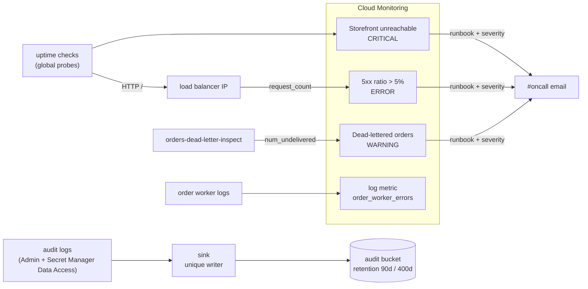

# Lesson 17 — Logging, Monitoring, and Observability

**Phase 3 · Intermediate** · Builds on lesson 16 · **Phase 3 capstone**

> Meridian now runs VMs, a fleet, Cloud Run services, a database, a message
> pipeline and a Kubernetes cluster. Last week the storefront was down for 40
> minutes before a customer emailed. Today you add the **eyes and the alarm**:
> uptime checks, alerts with runbooks, metrics from logs, and an audit trail
> nobody can quietly delete, all in Terraform, reviewed like any other change.

## Learning objectives

- Probe user-facing endpoints with uptime checks.
- Write alert policies that page on symptoms (unreachable, error ratio, stuck work), not noise.
- Give every alert a severity, a runbook and a channel.
- Turn log lines into metrics with log-based metrics.
- Enable Data Access audit logs, and export audit logs to retention-protected storage.
- (Challenge) Define an SLO and alert on error-budget burn rate.

## 1. Concepts

### Alert on symptoms

| Alert | Fires when | Why it's a good page |
|---|---|---|
| Storefront unreachable | uptime check fails from several regions for 2 min | Customers can't shop |
| 5xx ratio > 5% | errors ÷ all requests over 5 min | Customers see failures, whatever the traffic level |
| Dead-lettered orders | messages in the dead-letter subscription | Orders are stuck (lesson 14) |

Use a **ratio** (`denominator_filter`), not a raw count. 50 errors a minute is a disaster at
3 a.m. and noise during a sale. `duration` stops one bad sample from paging anyone.

### Every alert needs three things

```hcl
severity              = "CRITICAL"
documentation { mime_type = "text/markdown"  content = "What happened. First steps. Runbook link." }
notification_channels = [google_monitoring_notification_channel.oncall.id]
```

An alert without a channel fires into the void, and it looks fine in the console. That's the broken repo.

### Uptime checks

Google probes your URL from several continents every minute. Because the check targets the
**load balancer IP**, it measures what customers experience: DNS aside, the whole path
through the LB to a healthy backend.

### Log-based metrics

```hcl
resource "google_logging_metric" "worker_errors" {
  filter = "resource.type=\"cloud_run_revision\" AND resource.labels.service_name=\"meridian-order-worker\" AND severity>=ERROR"
}
```

Logs become a time series you can graph and alert on. Count what matters (errors),
not everything.

### Audit logs

| Log | On by default | Records |
|---|---|---|
| Admin Activity | ✅ always | Config changes (who changed IAM, created a VM) |
| **Data Access** | ❌ (most services) | Who *read* what: secrets, objects, rows |
| System Event | ✅ | Google-initiated actions |

Enable Data Access logs where reads matter. Who read the DB password? Then
export audit logs with a **sink** to a bucket with a retention policy. Logs in Cloud Logging
expire; compliance needs a trail that even a project Owner can't delete early.

```hcl
resource "google_logging_project_sink" "audit" {
  destination            = "storage.googleapis.com/${google_storage_bucket.audit.name}"
  filter                 = "logName:\"cloudaudit.googleapis.com\""
  unique_writer_identity = true                       # the sink gets its own SA...
}
resource "google_storage_bucket_iam_member" "audit_writer" {
  member = google_logging_project_sink.audit.writer_identity   # ...granted on this bucket only
  role   = "roles/storage.objectCreator"
}
```

## 2. How this lesson is checked offline

**Dev is planned against the deployed lesson 16 environment.** Expected: **10 to add, 0 to change,
0 to destroy**. Alert filters that interpolate values known only after apply (like the uptime check
ID) are checked by reading your HCL. The others are checked from plan values.

## 3. Architecture



## 4. Lab files

- [lab.md](lab.md): R17.1 – R17.10
- [challenge.md](challenge.md): C17.1 – C17.4 (SLO + burn rate, dashboard, Cloud SQL CPU, validated channel)
- [broken/](broken/): "the shop was down for 40 minutes and nobody was paged"

## 5. Phase 3 complete

Meridian is now a cloud-native platform: a private database, a serverless API, an event pipeline,
a Kubernetes cluster for batch jobs, a keyless CI/CD pipeline and production monitoring. Phase 4
turns to enterprise concerns: multi-project networking, security engineering, advanced Terraform,
resilience, disaster recovery and platform design.

## 6. If this were real

Uptime checks and alert policies are free at this scale. Data Access audit logs are billed as log
ingestion, so enable them for sensitive services only. The audit bucket costs pennies per GB in Coldline.
