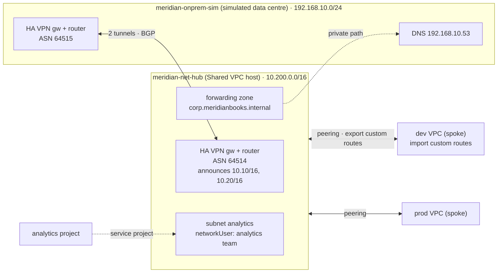

# Lesson 18 — Advanced GCP Networking

**Phase 4 · Advanced** · Builds on lesson 17 · Starts Phase 4

> Meridian has bought a small chain of physical bookstores. Their inventory system
> runs in a data centre, and the analytics team wants its own project. Today you
> build a **network hub**: a project that owns shared networking, connects to the
> data centre over **HA VPN with BGP**, shares subnets with other projects
> (**Shared VPC**), resolves corporate DNS names, and links dev and prod as
> **spokes**. It's also your first configuration that manages **two projects at once**.

## Learning objectives

- Configure several instances of the same provider (`alias`) and pass them to modules (`providers = {...}`, `configuration_aliases`).
- Build HA VPN between two networks: gateways, tunnels on both interfaces, Cloud Routers, BGP sessions.
- Design link-local BGP addressing and private ASNs, and control which routes are advertised.
- Connect spokes to a hub with peering and custom route exchange; explain non-transitivity.
- Share subnets with Shared VPC, granting `networkUser` per subnet.
- Configure hybrid DNS: outbound forwarding and inbound forwarding.

## 1. Concepts

### One configuration, several projects

```hcl
provider "google" {                      # default: the hub project
  project = var.hub_project_id
}
provider "google" {
  alias   = "onprem"                     # a second configuration
  project = var.onprem_project_id
}

module "onprem_network" {
  source    = "../../modules/network"    # the SAME module...
  providers = { google = google.onprem } # ...deployed into the other project
}
```

A module that needs two configurations declares them:

```hcl
terraform {
  required_providers {
    google = { source = "hashicorp/google", configuration_aliases = [google.peer] }
  }
}
resource "google_compute_ha_vpn_gateway" "peer" { provider = google.peer ... }
```

The "on-prem data centre" is simulated with a VPC in a second project, the standard way to
practise hybrid networking without hardware. The Terraform is almost identical for a real
peer: you'd use `google_compute_external_vpn_gateway` instead of a second HA gateway.

### HA VPN

```
hub HA gateway ── interface 0 ── tunnel 0 ── interface 0 ── on-prem HA gateway
               └─ interface 1 ── tunnel 1 ── interface 1 ─┘
```

Two tunnels, one per gateway interface, give the **99.99% SLA**. Each tunnel carries one BGP
session between the two Cloud Routers:

| | Hub | On-prem |
|---|---|---|
| ASN (private: 64512–65534) | 64514 | 64515 |
| tunnel 0 link `169.254.0.0/30` | `.1` | `.2` |
| tunnel 1 link `169.254.0.4/30` | `.5` | `.6` |

Pre-shared keys come from `random_password`, never typed. BGP then exchanges routes
dynamically: add a subnet, and the other side learns it.

### What the hub announces

By default a Cloud Router advertises only its own VPC's subnets. The spokes (dev, prod) are in
*other* VPCs, so on-prem would never learn them. `advertise_mode = "CUSTOM"` plus
`advertised_ip_ranges = ["10.10.0.0/16", "10.20.0.0/16"]` fixes that.

### Hub and spoke

Peering is **not transitive** (lesson 07). On-prem routes learned by the hub reach the spokes
only through **custom route exchange**:

- hub → spoke peering: `export_custom_routes = true` (share the VPN-learned routes)
- spoke → hub peering: `import_custom_routes = true` (accept them)

Both halves live in different configurations (hub root, dev root, prod root), each owned by the
team that owns that network.

### Shared VPC

The hub project becomes a **host**. The analytics project is attached as a **service project**,
and the analytics group gets `roles/compute.networkUser` on **one subnet**. Project-level
`networkUser` would give them every hub subnet.

### Hybrid DNS

- **Outbound:** a private *forwarding zone* for `corp.meridianbooks.internal` sends queries to the
  on-prem DNS server over the VPN (`forwarding_path = "private"`).
- **Inbound:** a DNS policy with `enable_inbound_forwarding` gives on-prem resolvers an IP in the
  hub to query Google Cloud private zones.

## 2. How this lesson is checked offline

- A new root, `envs/hub`, is planned alongside dev, prod and bootstrap. Checks read
  `plan.others["hub"]`.
- **dev is planned against the deployed lesson 17 environment.** Expected: **1 to add**, its
  hub peering. The hub plans **33** resources across two projects. Each resource's `project` shows which
  provider configuration it used.
- A lesson test for `modules/ha-vpn` runs *inside the module* (it declares
  `configuration_aliases`), with both provider configurations mocked.

## 3. Architecture



## 4. Lab files

- [lab.md](lab.md): R18.1 – R18.10
- [challenge.md](challenge.md): C18.1 – C18.4 (DNS peering for spokes, BGP MD5, global routing, validated link ranges)
- [broken/](broken/): "BGP is up, but dev still can't reach the stores"

## 5. If this were real

Each HA VPN tunnel costs about $0.05/hour (4 tunnels ≈ $150/month) plus egress. Cloud DNS
zones are cents. Shared VPC itself is free. For production bandwidth and latency,
Interconnect (Dedicated or Partner) replaces VPN, with the same BGP and Cloud Router concepts.
