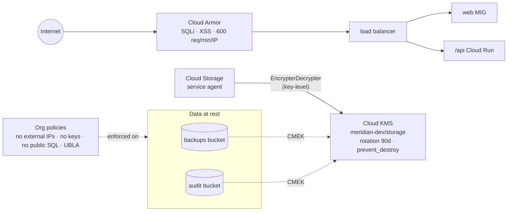

# Lesson 19 — Advanced Security Engineering

**Phase 4 · Advanced** · Builds on lesson 18

> A penetration test of the storefront found SQL-injection probes reaching the
> backends, and the auditors want three things: encryption keys Meridian
> controls, proof that nobody can re-open what the course closed (public IPs,
> keys, public buckets), and protection at the edge. Today you add **layered
> security** to the *deployed* platform, without recreating anything.

## Learning objectives

- Create Cloud KMS keys with rotation and protect them from deletion.
- Apply CMEK to existing resources, and know which resources can't take CMEK without being replaced.
- Grant key usage to Google service agents at key level, and order resources so the grant exists first.
- Put Cloud Armor in front of load balancer backends: OWASP rules, rate limiting, preview vs enforce.
- Enforce organization policy constraints, after verifying the platform already complies.
- (Challenge) Binary Authorization, Adaptive Protection and VPC Service Controls.

## 1. Concepts

### Defence in depth

| Layer | Control in this lesson | Stops |
|---|---|---|
| Edge | Cloud Armor: SQLi/XSS rules, per-IP rate limit | Injection probes, scraping, simple floods |
| Data | CMEK on backups and audit logs | Data readable without your key; enables crypto-shredding |
| Platform | Organization policies | Anyone (even Owners) re-adding public IPs, keys, public buckets |
| Supply chain | Binary Authorization (challenge) | Unknown images on GKE |
| API perimeter | VPC Service Controls (challenge) | Data exfiltration with stolen credentials |

### CMEK and the service agent

Google encrypts everything at rest by default. **CMEK** means the key is yours: you set rotation,
see every use in audit logs, and can disable it to make the data unreadable.

```hcl
resource "google_kms_crypto_key_iam_member" "storage_agent" {
  crypto_key_id = google_kms_crypto_key.storage.id
  role          = "roles/cloudkms.cryptoKeyEncrypterDecrypter"
  member        = "serviceAccount:service-<project number>@gs-project-accounts.iam.gserviceaccount.com"
}
```

Cloud Storage encrypts using its **service agent**, not your identity. Without this grant every write
to the bucket fails. That's the broken repo. The module's output `depends_on` the grant, so a bucket
that reads the key ID waits for it.

### CMEK on existing resources

| Resource | Add CMEK later? |
|---|---|
| Bucket default key | ✅ in place (new objects use the key) |
| Cloud SQL instance | ❌ **replacement**: new instance, migrate data |
| Persistent disk | ❌ replacement: snapshot, create an encrypted disk, swap |
| Secret Manager replication | ❌ replacement |

This lesson applies CMEK where it's an in-place change, and a fixture proves the checker catches
the Cloud SQL replacement (R19.9). For the rest, CMEK belongs in the *first* apply. That's why
platform teams bake it into modules from day one.

### Cloud Armor

```hcl
rule {
  priority = 1000
  action   = "deny(403)"
  match { expr { expression = "evaluatePreconfiguredWaf('sqli-v33-stable', {'sensitivity': 1})" } }
}
```

Rules are evaluated by priority. Preconfigured WAF rules implement the OWASP Core Rule Set. A
`throttle` rule with `enforce_on_key = "IP"` limits each client. `preview = true` logs matches
without blocking. That's useful for tuning, but a preview rule protects nothing. Attach the policy to
**every** backend. An unprotected `/api` path is the one attackers will use.

### Organization policies

Preventive controls enforced by the API for everyone, including Owners and your own Terraform:

| Constraint | Effect |
|---|---|
| `compute.vmExternalIpAccess` (deny all) | No VM may get an external IP |
| `storage.uniformBucketLevelAccess` | No per-object ACLs |
| `sql.restrictPublicIp` | No public Cloud SQL (lesson 12's broken repo becomes impossible) |
| `iam.disableServiceAccountKeyCreation` | No keys (lesson 10) |

**Before** enforcing, check nothing violates the constraint. Otherwise the next update to that
resource fails (R19.8).

## 2. How this lesson is checked offline

**Dev is planned against the deployed lesson 18 environment.** Expected: **11 to add, 4 to change, 0 to destroy**:

- the 4 changes are both buckets gaining CMEK and both backend services gaining the policy, all in place;
- adds are the key ring, key, key grant, KMS API, the security policy, and five organization policies plus their API.

## 3. Architecture



## 4. Lab files

- [lab.md](lab.md): R19.1 – R19.10
- [challenge.md](challenge.md): C19.1 – C19.4 (Binary Authorization, Adaptive Protection, VPC-SC dry run, rotation validation)
- [broken/](broken/): "since the encryption change, every backup fails"

## 5. If this were real

A KMS key costs $0.06 per key version per month plus operations. Cloud Armor Standard costs $5
per policy and $1 per rule per month plus requests. Organization policies are free, but setting
them at project level needs `orgpolicy.policyAdmin`, usually held by the security team.
