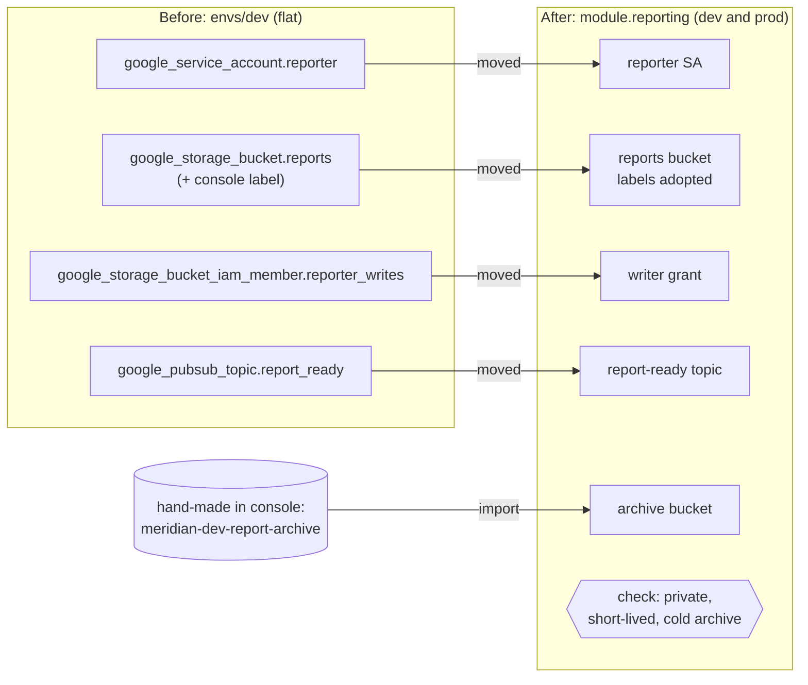

# Lesson 20 — Advanced Terraform Engineering

**Phase 4 · Advanced** · Builds on lesson 19

> In 2024 the reporting team needed a bucket for the nightly sales reports, so they pasted a
> flat Terraform file into the dev root "temporarily": hard-coded project, hard-coded names,
> no module, nothing in prod. Since then they've also created an archive bucket by hand in the
> console, and someone added a `cost-center` label to the reports bucket for finance, again by
> hand. Prod now needs reporting too. Today you turn the legacy file into a proper module and
> bring everything under Terraform **without destroying or recreating a single object**.

## Learning objectives

- Refactor resources into a module with `moved` blocks, and prove it with a plan that shows **0 to destroy**.
- Adopt resources created outside Terraform with `import` blocks, and write configuration that matches them exactly.
- Recognise drift in a plan, and decide whether to adopt it into the configuration or revert it.
- Write `check` blocks: post-conditions that are re-evaluated on every plan.
- Make a module reusable: variables with validation, a stated provider range, no environment-specific literals.
- (Challenge) Stop managing a resource without deleting it (`removed`), import many objects with one `for_each` import block, and protect adopted data with `prevent_destroy`.

## 1. Concepts

### Addresses are not objects

Terraform state maps an **address** (`google_storage_bucket.reports`) to a real **object**
(the bucket `meridian-dev-sales-reports`). Moving the resource block into a module changes the
address to `module.reporting.google_storage_bucket.reports`. Without help, Terraform sees one
address with no configuration (so it **destroys** that object) and one new address with no
object (so it **creates** one). For a bucket that means deleting the data, and then the create
fails because the name is still being released.

```hcl
moved {
  from = google_storage_bucket.reports
  to   = module.reporting.google_storage_bucket.reports
}
```

A `moved` block tells Terraform it's the same object under a new address. The plan then shows
`# google_storage_bucket.reports has moved to module.reporting.google_storage_bucket.reports`
and no destroy. Moves *into* a module are declared in the **calling** module (here, the root).

| Change | Does Terraform work it out? |
|---|---|
| Adding `count` to a single resource (`x` → `x[0]`) | Yes, automatically |
| Renaming a resource, or moving it into or out of a module | No: needs `moved` |
| Changing `count` to `for_each`, or renaming `for_each` keys | No: needs one `moved` per instance |

Keep `moved` blocks until **every** state that had the old addresses has been applied: other
environments, other people's workspaces, and anyone using your module. In a shared module, they
are part of your public interface.

### Importing what was created by hand

```hcl
import {
  to = module.reporting.google_storage_bucket.archive
  id = "meridian-dev-report-archive"
}
```

An `import` block (Terraform 1.5+) makes adoption a reviewable part of the plan, instead of a
`terraform import` command someone runs from a laptop. Three rules:

1. `import` blocks live in the **root module**, and `to` may point into a module.
2. The `id` format depends on the resource type. The provider docs list it under *Import* at the
   bottom of each resource page (a bucket accepts `name` or `project/name`).
3. Importing only puts the object in state. If your configuration doesn't match the object, the
   **same plan** shows an update that would change the real bucket. The import is only done when
   the plan shows *no changes* for it.

`terraform plan -generate-config-out=generated.tf` writes a first draft of the configuration for
you. Treat it as a starting point: it lists every attribute, including defaults you don't want to pin.

### Drift: adopt or revert?

Drift is a difference between the real object and the configuration. Here, someone added the label
`cost-center = analytics` in the console. The plan proposes removing it. Applying would *revert*
the change, and that's the right thing only if the change was wrong. Finance asked for this label,
so the fix is to **adopt** it into the configuration. A plan isn't a to-do list: read every update
and ask who made the difference and why.

### Checks, validations and conditions

| Mechanism | Evaluated | On failure | Use for |
|---|---|---|---|
| `variable` `validation` | Before planning | Error | Bad inputs (`retention_days = 7`) |
| `precondition` / `postcondition` | While planning or applying one resource | Error | Assumptions a resource needs |
| `check` block | At the end of every plan and apply | **Warning** | Ongoing health of what's deployed |

A `check` doesn't block a plan, which is exactly why it suits drift and post-conditions: it tells
you something is wrong without stopping an urgent fix from shipping.

### Reusable modules

- **Inputs, not literals.** The legacy file hard-coded `meridian-dev-4821`. The module takes
  `project_id` and `name_prefix`, so prod reuses it unchanged.
- **State a provider range** in the module (`>= 8.0, < 9.0`). The root pins the exact version (lock file).
- **Version the module** when other repositories use it: `source = "git::https://...//modules/reporting?ref=v1.2.0"`
  or a private registry with `version = "~> 1.2"`. Inside one repository, a relative path is
  versioned by the commit.

## 2. How this lesson is checked offline

- **Dev is planned against the deployed environment**: lesson 19, plus the legacy reporting
  resources, plus the console drift (`state/dev.tfstate`). The starter's plan shows that drift:
  **0 to add, 1 to change**.
- **Import blocks are simulated.** A real import reads the object from the Google API, which the
  course can't call. `state/dev.cloud.json` lists what exists in the project but not in state
  (the hand-made buckets). Before planning, the checker looks up each import `id` there:
  - if it's found, the checker writes the object into state at the `to` address, which is what a real import does;
  - if it isn't found, the plan fails with "Cannot import non-existent remote object", as it would for real.

  The simulator supports literal values and `for_each` over a literal list, set, map or local.
- Expected lab result: **Plan: 0 to add, 0 to change, 0 to destroy**, with 1 import.

## 3. Architecture



## 4. Lab files

- [lab.md](lab.md): R20.1 – R20.10
- [challenge.md](challenge.md): C20.1 – C20.4 (`removed`, `for_each` import, `prevent_destroy`, validation tests)
- [broken/](broken/): "the refactor PR wants to delete the reports bucket"

## 5. If this were real

No new cost: every object already exists. The risk is the **apply order**. Merge the refactor,
apply dev, check that the plan is empty, and only then let anyone else touch the reporting code.
Run `terraform state list` before and after. An import needs read permission on the object (here
`storage.buckets.get`), and the identity that applies needs to be able to manage it from then on.
