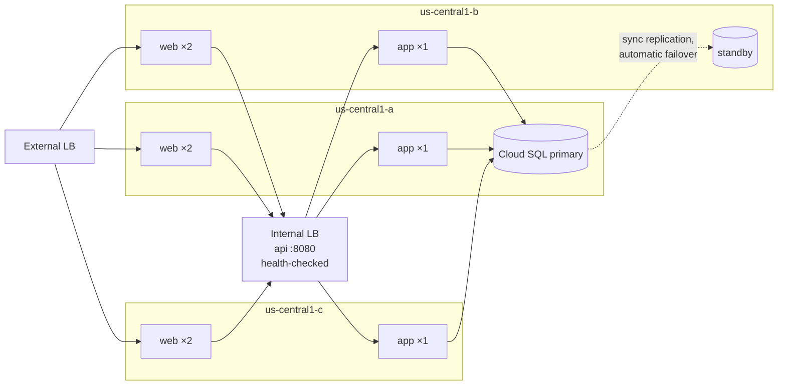

# Lesson 21 — High Availability and Fault Tolerance

**Phase 4 · Advanced** · Builds on lesson 20

> Last month `us-central1-a` had a two-hour partial outage. The storefront stayed up, because the
> web tier is a regional MIG, but checkout didn't: the API ran on **one VM in one zone**. The
> board wants a promise: *production survives the loss of any single zone, with enough capacity
> to serve normal traffic.* Today you find every single point of failure, remove the ones prod
> can't afford, and prove the capacity numbers before anything is deployed.

## Learning objectives

- Identify failure domains (zone, region) for VMs, MIGs, Cloud SQL, GKE and serverless services.
- Replace a zonal single VM with a regional MIG behind a regional internal load balancer.
- Size capacity for N−1 zones: what's left after losing one zone, at minimum and at peak.
- Wire health checks correctly: load balancing vs autohealing, and the firewall ranges they come from.
- Decommission stateful infrastructure safely (`removed`, and why `prevent_destroy` doesn't help).
- (Challenge) Define an SLO with an error budget and alert on fast burn.

## 1. Concepts

### Failure domains

| Resource | Failure domain | Survives a zone loss? |
|---|---|---|
| `google_compute_instance`, zonal MIG, `google_compute_disk` | Zone | No |
| Regional MIG (`distribution_policy_zones`) | Zones it spreads across | Yes, with reduced capacity |
| Cloud SQL `ZONAL` | One zone | No (restore from backup) |
| Cloud SQL `REGIONAL` | Primary + standby in two zones | Yes: automatic failover, about a minute of errors |
| GKE cluster with `location = region` (Autopilot) | Region | Yes |
| Cloud Run, Cloud Functions, Pub/Sub, Cloud Storage | Region or multi-region | Yes, Google handles it |
| External Application LB, internal regional LB | Global / regional | Yes |

A **single point of failure** is anything whose failure domain is one zone *and* that the service
can't run without. Dev has one on purpose (a `ZONAL` database is half the price). Prod can't have any.

### N−1 capacity

A regional MIG with `EVEN` distribution keeps the same number of VMs in each zone, so one zone
holds at most `ceil(n / zones)` VMs. That's what a zone loss costs:

| VMs (min) | Zones | Lost with one zone | Left |
|---|---|---|---|
| 3 | 3 | 1 | 2 |
| 4 | 3 | 2 | **2** (one zone holds 2) |
| 6 | 3 | 2 | 4 |
| 2 | 2 | 1 | 1 |

The autoscaler will replace the lost VMs in the surviving zones, but that takes minutes. Size the
**minimum** for the traffic you must serve during those minutes, and the **maximum** so that peak
fits after a zone loss (the challenge). Set `distribution_policy_target_shape = "EVEN"` explicitly:
`BALANCED` and `ANY` let the MIG concentrate VMs where capacity is available, and then this table no longer holds.

### Two health checks, two jobs

| | Load balancer health check | Autohealing health check |
|---|---|---|
| Question | Should this VM get new connections? | Is this VM broken beyond repair? |
| Action | Stop sending traffic, within seconds | Delete and recreate the VM |
| Tuning | Fast (5 s interval, 2 failures) | Tolerant (15 s, 4 failures, initial delay for boot) |

Both come from Google's health checkers, `35.191.0.0/16` and `130.211.0.0/22`. Without a firewall rule
allowing them **on the serving port**, every VM is unhealthy: the load balancer has no backends, and
autohealing recreates the VMs forever.

### Decommissioning stateful resources

Switching `module "app"` from `vm-service` to `mig-service` removes the VM, its disk attachment
and snapshot schedule from the configuration. The data disk had `prevent_destroy = true`, but
**`prevent_destroy` only protects resources that are still in the configuration**: remove the block
and Terraform plans the delete. To keep the disk while you migrate its data:

```hcl
removed {
  from = module.app.google_compute_disk.data
  lifecycle { destroy = false }
}
```

The plan shows `forget`. The disk keeps existing, unmanaged, until someone deletes it on purpose.

### SLOs and error budgets (challenge)

An SLO of 99.5% over 28 days allows 0.5% of requests to fail: that's the **error budget**. The
burn rate is how fast you spend it. A rate of 1 spends exactly the budget in 28 days; a rate of
13.44 spends 2% of it in one hour and the whole budget in about two days. Alerting on burn rate pages
for real incidents and stays quiet for a few stray errors.

## 2. How this lesson is checked offline

- **Dev is planned against the deployed lesson 20 environment.** Expected: **8 to add, 1 to change,
  4 to destroy**, plus 1 to forget. The 4 destroys are the old app VM's own pieces (VM, disk
  attachment, snapshot schedule and its attachment). The service account and its roles are kept,
  because `mig-service` uses the same addresses as `vm-service`. The change is the web MIG gaining
  an explicit `EVEN` shape.
- **Failure-domain analyser** (`coursekit/failure.py`): reads every VM, MIG (with its autoscaler),
  Cloud SQL instance, GKE cluster and Memorystore instance from the plan, "removes" each zone in turn,
  and recomputes capacity. R21.5, R21.6 and C21.3 use it on **prod**.

## 3. Architecture



Prod at minimum scale: losing any zone leaves 4 web VMs, 2 app VMs and a database (after failover).

## 4. Lab files

- [lab.md](lab.md): R21.1 – R21.10
- [challenge.md](challenge.md): C21.1 – C21.4 (SLO, burn-rate alert, peak capacity, MIG validation)
- [broken/](broken/): "the API went dark right after the HA rollout"

## 5. If this were real

Prod at minimum goes from 3 web VMs and 1 app VM to 6 web and 3 app VMs: five more e2-micro VMs,
roughly +$35/month. A REGIONAL Cloud SQL instance costs twice a zonal one. Internal load balancing costs about
$18/month per forwarding rule plus data processing. Run a **game day** before you trust it: drain
one zone (set the MIGs' zones to two, or stop the VMs in one zone) and watch the SLO dashboard.
