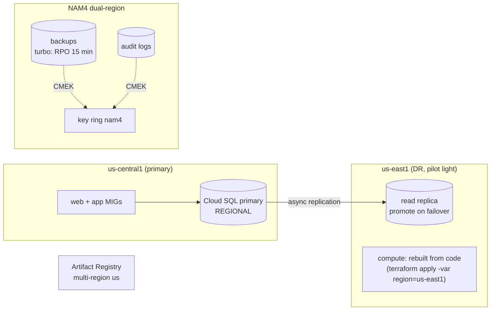

# Lesson 22 — Disaster Recovery and Business Continuity

**Phase 4 · Advanced** · Builds on lesson 21

> Lesson 21 made prod survive a zone. The insurer's question is harder: *what if all of
> `us-central1` is gone for a day?* The business agreed recovery objectives: lose at most
> **5 minutes** of orders, **15 minutes** of backups, no container images, and be back within an
> hour or so. Today you build the DR footprint in **us-east1** and let the checker prove, from
> the plan, that the configuration can meet those numbers. Dev, meanwhile, must not change at all.

## Learning objectives

- Define RPO and RTO per data store, and tell which architecture can meet which objective.
- Add a cross-region Cloud SQL read replica and know the promotion steps.
- Choose bucket locations (regional, dual-region, multi-region) and turbo replication from an RPO.
- Keep CMEK working when data moves: keys must live where the data lives.
- Introduce prod-only features behind inputs whose defaults keep other environments unchanged.
- (Challenge) Make the replica able to take the load, generate the failover steps, and keep database backups out of the region.

## 1. Concepts

### RPO and RTO

- **RPO** (recovery point objective): how much data you may lose, measured in time.
- **RTO** (recovery time objective): how long you may be down.

Each data store gets its own, because each one costs differently to protect:

| Data store | Architecture | RPO after losing the region |
|---|---|---|
| Cloud SQL | Backups only (stored multi-region by default) | Up to 24 h (last backup; PITR logs are regional) |
| Cloud SQL | **Cross-region read replica** | Seconds (replication lag) |
| Bucket | Regional | Everything: the data is gone |
| Bucket | Dual-region / multi-region, default replication | Up to 12 h (99.9% of objects within an hour) |
| Bucket | **Dual-region + turbo replication** (`rpo = "ASYNC_TURBO"`) | 15 minutes, guaranteed |
| Artifact Registry | Regional | Everything (you'd rebuild every image) |
| Artifact Registry | **Multi-region** (`us`) | Nothing lost |

RTO depends on people and procedure as much as on Terraform: promoting a replica takes minutes,
re-creating 140 resources in another region with `terraform apply` takes longer, and DNS or client
caches add more. Write the RTO down, then **test it** (a DR drill).

### Warm standby vs pilot light vs backup-and-restore

| Strategy | What runs in the DR region | RTO | Cost |
|---|---|---|---|
| Backup and restore | Nothing; backups are elsewhere | Hours to days | Lowest |
| **Pilot light** | Data replicated; compute is rebuilt from code | About an hour | Low |
| Warm standby | Data + scaled-down compute | Minutes | Medium |
| Active-active | Everything, serving traffic | About zero | Highest, and complex |

Meridian chooses **pilot light**: the database, backups, audit logs and images are already in
us-east1, and the compute is rebuilt from this repository (it's regional and parameterised).

### Prod-only features without touching dev

Every new input defaults to the **old behaviour**: `dr_region = null` creates no replica,
`storage_location = null` keeps buckets in `var.region`, `turbo_replication = false`. Dev's plan
stays empty, which R22.9 checks. Watch out: changing a bucket's `location` (or a key ring's)
**replaces** it, which deletes the data. That's why dev must never pick up prod's values.

### CMEK follows the data

A CMEK key must be in the **same location** as the bucket it encrypts. A `NAM4` bucket needs a key
ring in `nam4`, and a regional key in `us-central1` would make the bucket creation fail (and be
lost with the region anyway). In this lesson the `kms` module takes the same `storage_location`.

## 2. How this lesson is checked offline

- **Dev is planned against the deployed lesson 21 environment:** expected **No changes**.
- **Prod is analysed for region loss** (`coursekit/failure.py`, `data_stores` and `lose_region`):
  - every bucket, Cloud SQL instance (with its replicas) and repository gets the regions holding a copy, plus the RPO its architecture can achieve;
  - R22.7 compares that RPO with your `recovery_objectives`;
  - R22.8 removes `us-central1` and checks that the critical data still exists somewhere.
- Not checked: the RTO (it's declared, not computed). Drills, people and runbooks are the
  capstone's job.

## 3. Architecture

## 4. Lab files

- [lab.md](lab.md): R22.1 – R22.10
- [challenge.md](challenge.md): C22.1 – C22.4 (replica sizing, generated failover steps, backup location, module validation)
- [broken/](broken/): "the DR drill found no replica"

## 5. If this were real

- **Replica:** costs as much as a primary of the same tier (prod: about $150/month), plus cross-region replication traffic.
- **Dual-region storage:** costs more than regional, and turbo replication adds a per-GB charge.
- **Multi-region registry:** costs a bit more per GB.
- **Drills:** run a DR drill at least yearly. Promote a *clone*, not the real replica, and time every step against the RTO.
