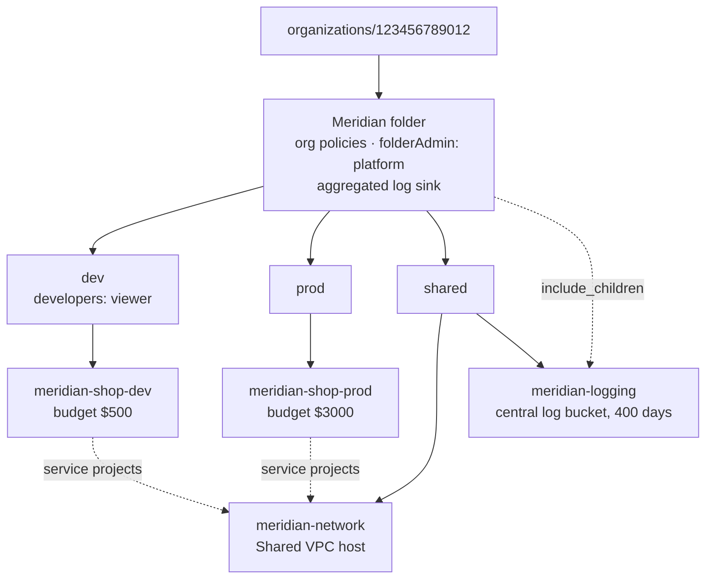

# Lesson 23 — Enterprise Architecture and Platform Engineering

**Phase 4 · Advanced** · Builds on lesson 22

> Meridian has been acquired. The new parent company has an organisation with a hundred
> projects, nobody knows who owns half of them, and last quarter's cloud bill had a
> five-figure line called "misc". Your platform is the one that works, so the CTO asks you
> to turn it into the **landing zone** every team starts from: folders per environment,
> guardrails and access set once and inherited, a project factory that won't create an
> unlabelled or unbudgeted project, a Shared VPC, and every log in one place.

## Learning objectives

- Design a resource hierarchy (organization → folders → projects) and use inheritance for policy and IAM.
- Build a project factory module: projects from a map, mandatory labels enforced by validation, safe defaults.
- Attach a budget with alerts to every project (FinOps from day one).
- Connect workload projects to a Shared VPC host.
- Centralise logs with a folder-level aggregated sink, and grant its writer identity.
- Keep the landing zone in its own root, separate from the workloads.
- (Challenge) Essential contacts, a location policy, cost-aware log exclusions, and project ID limits.

## 1. Concepts

### The resource hierarchy

```
organizations/123456789012
└── Meridian                 org policies, platform team, log sink, contacts
    ├── dev                  developers: viewer
    │   └── meridian-shop-dev
    ├── prod
    │   └── meridian-shop-prod
    └── shared
        ├── meridian-network   Shared VPC host
        └── meridian-logging   central log bucket
```

Policies and IAM **inherit downwards**. A guardrail on `Meridian` applies to every project below
it, including projects created next year by someone who never read this repository. Grant at the
**lowest level that covers the need**. An organization-level grant applies to the whole company,
which is why R23.9 refuses them here.

### A project factory

Hand-made projects drift: one has a default network, one has no owner label, one has no budget.
A factory module turns "how we make a project" into code:

```hcl
projects = {
  "meridian-shop-dev" = { folder = "dev", env = "dev", cost_center = "cc-1001", owner = "team-storefront", budget = 500, shared_vpc = true }
}
```

- **Validation** makes the labels mandatory: `cost_center` must match finance's `cc-NNNN`, and `env` is one of three values.
- `deletion_policy = "PREVENT"` stops `terraform destroy` from deleting a project.
- `auto_create_network = false` skips the default VPC, which comes with permissive firewall rules.
- A `random_id` suffix keeps project IDs globally unique. They're permanent and limited to 30 characters (challenge).

### FinOps: labels and budgets

Labels let billing exports answer "what does team X cost?". A budget doesn't stop spending; it
**alerts**. Use several thresholds: 50% and 90% as early warnings, 100% actual, and 100% *forecasted*
(the most useful one, since it fires before the money is spent). Automate a response (e.g. Pub/Sub
→ function) only for sandboxes. Never cap production.

### Aggregated log sinks

A `google_logging_folder_sink` with `include_children = true` copies logs from every project under
the folder, including future ones, to one destination. The sink writes as its own service account
(`writer_identity`), which needs `roles/logging.bucketWriter` on the destination project. Without
it, nothing errors and nothing arrives.

### Separate roots for separate blast radii

The landing zone lives in `envs/platform`, with its own state and pipeline. A mistake in a workload
PR can't touch folders or org policies, and the platform's state (which can delete projects) is
guarded separately.

## 2. How this lesson is checked offline

- **A new root:** `plan.others["platform"]` is the landing zone, planned with a fake organization ID
  and billing account (`Plan: 40 to add`). Folder and project numbers are unknown until apply, so checks
  follow **references** (`folder_id` → `google_folder`, `parent` → the Meridian folder) instead of values.
- **Dev against the deployed lesson 22 environment:** expected **No changes** (R23.10).
- **Module tests:** `tests/lab/modules/project-factory` runs inside the factory with mock providers
  and proves the validations reject bad labels.

## 3. Architecture



## 4. Lab files

- [lab.md](lab.md): R23.1 – R23.10
- [challenge.md](challenge.md): C23.1 – C23.4
- [broken/](broken/): "the central log bucket is almost empty"

## 5. If this were real

You need an organization (Cloud Identity or Workspace), `roles/resourcemanager.folderAdmin`,
`roles/billing.user` on the billing account, and `roles/orgpolicy.policyAdmin`. Run the platform
pipeline with its own service account, in its own seed project. Folders, policies and budgets are
free; central logs cost $0.50/GiB ingested beyond the free tier, which is why the challenge excludes
the noisiest ones. Google's **Cloud Foundation Fabric** and the **terraform-google-project-factory**
module are production-grade versions of what you build here.
