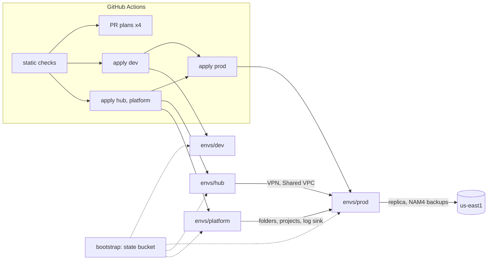

# Lesson 24 — Advanced System Design: Capstone

**Phase 4 · Advanced** · Builds on lessons 01–23

> The board approves the move of every Meridian system onto your platform. Before it does, an
> external reviewer will spend one day with your repository and nothing else. Three things they
> ask for: **proof** it still does everything it did (nothing quietly regressed in 23 lessons),
> **automation** that applies every root safely, and **explanations**: why it is built this
> way, and what happens when a zone or a region fails. Their checklist is this lesson.

## Learning objectives

- Treat earlier requirements as **regression tests**, and fix a regression they uncover.
- Run one pipeline for five roots: validate everything, plan every environment on pull requests,
  and promote dev → shared → prod behind environments.
- Test the platform modules so past mistakes (lesson 23's silent log sink) can't come back.
- Document the system as code: an architecture diagram, decision records (ADRs), and a failure analysis
  whose numbers are **checked against the plan**.
- (Challenge) Score yourself against a rubric with evidence; analyse region loss against agreed
  objectives; detect drift on a schedule; apply exactly the plan a reviewer approved.

## 1. Concepts

### Baselines: requirements as regression tests

Every earlier lesson ended with requirements that passed. Since then you've moved resources,
swapped single VMs for MIGs, added a DR region and a landing zone. Did any of that undo an earlier
guarantee? The capstone re-runs about 130 of the earlier lab requirements against today's plans,
grouped by phase (R24.1–R24.4). It leaves out the ones that only made sense once: "deployed dev
changes safely" against that lesson's state, and move or import exercises.

One of them fails on the starter. Lesson 22's DR replica is `ZONAL`, so lesson 21's "no single
point of failure in prod" no longer holds. Lesson 22's own checks never looked at zones. That's
exactly the kind of regression a baseline suite exists to catch.

> **Takeaway:** a requirement you checked once is a requirement you will eventually break. Keep
> running it.

### One pipeline, five roots

| Root | Plans on PR | Applies on main | Environment |
|---|---|---|---|
| `bootstrap` | – (validated only; applied by hand once) | – | – |
| `envs/dev` | ✔ | first | `dev` |
| `envs/hub`, `envs/platform` | ✔ | after checks | `hub`, `platform` (reviewers) |
| `envs/prod` | ✔ | **after dev** | `prod` (reviewers) |

A matrix keeps it short (`root: [dev, prod, hub, platform]`, `terraform -chdir=envs/${{ matrix.root }}`).
`needs:` orders the applies. GitHub environments hold the approval rules. The read-only plan
identity and the apply identity stay separate. Lesson 16's `meridian-ci-apply` only holds roles in its
own project, and bootstrap only lets it reach `envs/dev/` or `envs/prod/` state. A real pipeline for
`hub` and `platform` needs its own apply identity (and state grant) per root: folder and organization
roles for `platform`. Use the environment's variables to give each job the right one. Lesson 16's checks still run (one workflow file,
read-only token, static checks without credentials). R24.5 takes over its single-root apply rules.

### Documentation that can be checked

A reviewer can't run your platform, but they can read it. The checks hold docs to two standards:

- **Structure, from a rubric** ([rubric.json](rubric.json)). An ADR needs a `Status:` line plus Context,
  Decision, Alternatives considered and Consequences sections, each long enough to say something. Together,
  your ADRs must cover the landing zone, the network topology and disaster recovery.
- **Facts, from the plan.** The architecture diagram must name every component the plans build: add
  GKE and forget the diagram, and R24.7 tells you. The failure analysis table must hold the same
  numbers `coursekit.failure` computes: halve prod's web tier, and R24.9 says the doc is stale.

An ADR (Architecture Decision Record) is a short, numbered, immutable note: `docs/adr/0003-cross-region-dr.md`.
When a decision changes, write a new ADR and mark the old one `Superseded`. The history is the point.

### Failure analysis, in numbers

For each prod workload: capacity at **minimum** scale, and what is left after the worst single
zone loss. A regional MIG with `EVEN` distribution over 3 zones holds at most `ceil(n/3)` VMs per
zone, so web 6 → 4 and app 3 → 2. Cloud SQL `REGIONAL`, regional GKE and Cloud Run fail over and
keep everything. The challenge adds region loss: RPO per data store against `recovery_objectives`.

### Drift and reviewed plans (challenge)

- **Drift:** someone changes prod in the console. A scheduled `plan -detailed-exitcode` (exit code 2 =
  changes) catches it the next morning, with the read-only identity.
- **Reviewed plans:** `apply -auto-approve` after an approval re-plans, so it may apply something
  the approver never saw. Save the plan (`-out=tfplan`), upload it as an artifact, and have the
  approved job apply **that file**.

## 2. How this lesson is checked offline

- **Baselines** load earlier lessons' `checks.py` through `coursekit.baseline` and run selected
  requirements against this lesson's plans. A failure names the original requirement, so
  `python course.py check NN` on that lesson explains it in full.
- **Dev against the deployed lesson 23 environment:** expected **No changes** (R24.10). The
  replica fix only touches prod, where `dr_region` is set.
- **Module tests** you write under `modules/*/tests` run in the test stage. A failing test fails the check.
- **Docs** are read with `coursekit.docs` (headings, tables, mermaid blocks). Numbers in tables are
  compared with `coursekit.failure`, which reads the prod plan.

## 3. Architecture

The diagram students produce in `docs/architecture.md` (the reference version):

## 4. Lab files

- [lab.md](lab.md): R24.1 – R24.10
- [challenge.md](challenge.md): C24.1 – C24.4
- [rubric.json](rubric.json): ADR structure, diagram components and self-assessment criteria
- [broken/](broken/): "the failure analysis says we're fine"

## 5. If this were real

A real review would also ask for cost per environment (billing export plus labels), a tested
restore (promote the replica in a sandbox and time it), load tests behind the capacity numbers, and
named on-call owners for each alert. The `prod` and `platform` environments would require two
reviewers, and only the platform pipeline's identity would hold organization roles. Tools that do
some of this work for you: `terraform-docs` (module READMEs), Infracost (cost in PRs), `adr-tools`,
and Terraform's `check` blocks for continuous assertions.
