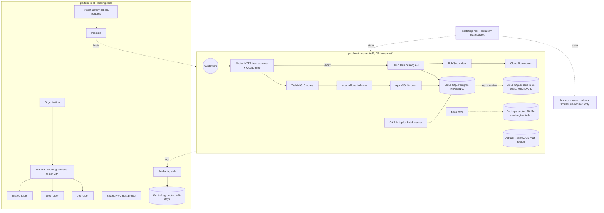

# Architecture

Meridian Books runs on five Terraform roots. Each has its own state and its own pipeline job.

| Root | Scope | What it owns |
|---|---|---|
| `bootstrap` | one project | The hardened, versioned state bucket every other root uses |
| `envs/platform` | organization | The landing zone: folders, guardrails, project factory, budgets, central logging |
| `envs/hub` | network projects | Hybrid network: HA VPN to on-prem, hub-and-spoke peering, Shared VPC, hybrid DNS |
| `envs/dev` | dev project | The shop, small: two zones, no DR footprint |
| `envs/prod` | prod project | The shop, production-sized: three zones, DR in us-east1 |

dev and prod call exactly the same modules; only `terraform.tfvars` differs.

## Request path

Customers reach the global load balancer, where Cloud Armor filters SQL injection and XSS and
rate-limits each client. Static pages come from the web MIG. `/api/*` goes to the Cloud Run catalog
service. Orders are published to Pub/Sub and processed by a private worker, retried with backoff,
and dead-lettered after a few attempts.

## Decisions

See [adr/](adr/) for why the platform looks like this, and
[failure-analysis.md](failure-analysis.md) for what happens when parts of it fail.
